# IChop 

## Installation

Install the development version of `IChop` from GitHub:

```r
devtools::install_github("yuchenxiao95/IChop")
```

You also need Julia (≥ 1.9), which you can download from
<https://julialang.org/downloads/>. Then connect R to Julia; the first time,
also install the Julia packages the package uses:

```r
library(IChop)
setup_julia()
install_julia_packages()   # first time only
```

The same methods are available as a Julia package,
[IChop.jl](https://github.com/yuchenxiao95/IChop.jl),
if you would rather work in Julia directly.

## Overview

IChop addresses the computational barrier of solving
$\ell_0$-penalized regression in linear models where the number of
predictors $p$ is large, in the hundreds or even the thousands, yet smaller
than the number of observations $n$. Finding the optimal solution of
$\ell_0$-penalized regression has been treated as a combinatorial problem
that requires discrete optimization and is NP-hard. This package builds on a
connection with Hopfield networks, which are used for associative memory
retrieval ([Xiao and Walker, 2026](https://doi.org/10.1007/s11222-026-10853-5)).
It makes generalized information criteria (GIC;
[Kim, Kwon and Choi, 2012](https://jmlr.org/papers/v13/kim12a.html)) for variable selection,
which are equivalent to $\ell_0$-penalized regression, computationally
feasible. The rationale is that there remains strong interest in GIC, whose
statistical properties are superior to those of $\ell_1$-based
regularization.

### The Hopfield network

A Hopfield network ([Hopfield, 1982](https://doi.org/10.1073/pnas.79.8.2554)) is a model of associative memory with $p$
neurons, each connected to every other neuron by undirected edges with no
self-connections. The state $z \in \lbrace 1, -1 \rbrace^p$ evolves through a
symmetric weight matrix $W$, built from a stored pattern $z_s$ by Hebb's law,
$W = z_s^\top z_s - I$, so that $W_{ij} = W_{ji} = z_i z_j$ and $W_{ii} = 0$.
The network updates one neuron at a time,

$$
z_i(t+1) = \mathrm{sgn}\big(H_i(t)\big), \qquad
H_i(t) = \sum_{j \ne i} w_{ij} z_j(t),
$$

with $\mathrm{sgn}(H) = 1$ if $H \ge 0$ and $-1$ otherwise, cycling
through $i = 1, \dots, p$ until $z$ is stable. Each update can only lower the
energy

$$
E(z) = -z^\top W z ,
$$

and $E$ is bounded below, so the network always converges to a locally stable
state ([Bruck, 1990](https://doi.org/10.1109/5.58341)).

### Connection with AIC

Write the linear model with inclusion indicators $z_j \in \lbrace 0, 1 \rbrace$:

$$
y_i = \sum_{j=1}^{p} x_{ij} z_j \beta_j + \sigma \varepsilon_i ,
\qquad\text{or}\qquad
y = X D_t^p \beta + \sigma \varepsilon ,
$$

where $D_t^p = \mathrm{diag}(z_1, \dots, z_p)$ has $t$ nonzero entries, so
$X_t = X D_t^p$ holds the true predictors. For a candidate model
$X_d = X D_d^p$ with hat matrix $H_d = X_d (X_d^\top X_d)^{-1} X_d^\top$, AIC
is an asymptotically unbiased estimate of

$$
\frac{1}{n} \beta^\top X_t^\top H_d X_t \beta
= \frac{1}{n} \langle X_t \beta, X_t \beta \rangle_{H_d}
= \frac{1}{n} \langle X_t \beta, \widehat{X_t \beta} \rangle ,
$$

where $\widehat{X_t \beta} = H_d X_t \beta$. Maximizing it minimizes the
expected out-of-sample error and finds the optimal orthogonal projection onto
the span of $X_t \beta$, reached when $X_d = X_t$. This quantity plays the
role of the energy term in a Hopfield network and allows the indicators to be
updated one at a time:

$$
z_j(t+1) = \mathbf{1}\left\lbrace
\frac{1}{n} \beta^\top X_t^\top H_{d+1} X_t \beta >
  \frac{1}{n} \beta^\top X_t^\top H_d X_t \beta \right\rbrace ,
$$

where $H_{d+1}$ includes $x_j$. Under these updates the energy term is
nondecreasing and bounded above by
$\frac{1}{n} \beta^\top X_t^\top X_t \beta$. The true signal is unknown, but it
is linked to the data through

$$
\frac{1}{n} \beta^\top X^\top H_d X \beta
= \mathbb{E}\left[ \frac{1}{n} y^\top H_d y \right] - d \frac{\sigma^2}{n}
\xrightarrow{p} \mathbb{E}\left[ \beta^\top X^\top H_d X \beta \right] .
$$

Replacing the unknown signal with the data gives the update rule for AIC,

$$
z_j(t+1) = \mathbf{1}\left\lbrace
\frac{1}{n} y^\top H_{d+1} y - 2(d+1) \frac{\sigma^2}{n} >
  \frac{1}{n} y^\top H_d y - 2d \frac{\sigma^2}{n} \right\rbrace ,
$$

and, for any GIC with penalty $p(n, d)$,

$$
z_j(t+1) = \mathbf{1}\left\lbrace
\frac{1}{n} y^\top H_{d+1} y - p(n, d+1) >
  \frac{1}{n} y^\top H_d y - p(n, d) \right\rbrace .
$$

This establishes a connection between the expected out-of-sample MSE and the
energy function of the Hopfield network for associative memory, where the
stable local minima in the energy function of the Hopfield network correspond
to optimal sparse solutions.

AIC is minimax-rate optimal but inconsistent when a true model exists;
criteria with stronger penalties achieve consistency. Table 1 lists the
criteria in the package and their penalties $p(n, d)$, where $d$ is the number
of selected variables and $p$ the number of candidate predictors:

| Name | $p(n, d)$ | Reference |
|:--|:--|:--|
| AIC | $2d \frac{\sigma^2}{n}$ | [Akaike (1974)](https://doi.org/10.1109/TAC.1974.1100705) |
| BIC | $d \frac{\sigma^2}{n} \log n$ | [Schwarz (1978)](https://doi.org/10.1214/aos/1176344136) |
| GIC2 | $d \frac{\sigma^2}{n} p^{1/3}$ | [Kim et al. (2012)](https://jmlr.org/papers/v13/kim12a.html) |
| GIC3 | $2d \frac{\sigma^2}{n} \log p$ | [Kim et al. (2012)](https://jmlr.org/papers/v13/kim12a.html) |
| GIC4 | $2d \frac{\sigma^2}{n} (\log p + \log\log p)$ | [Kim et al. (2012)](https://jmlr.org/papers/v13/kim12a.html) |
| GIC5 | $d \frac{\sigma^2}{n} \log\log n \log p$ | [Kim et al. (2012)](https://jmlr.org/papers/v13/kim12a.html) |
| GIC6 | $d \frac{\sigma^2}{n} \log n \log p$ | [Kim et al. (2012)](https://jmlr.org/papers/v13/kim12a.html) |
| CAIC | $d \frac{\sigma^2}{n} (\log n + 1)$ | [Bozdogan (1987)](https://doi.org/10.1007/BF02294361) |
| CAICF | $d \frac{\sigma^2}{n} (\log n + 1) + \frac{\sigma^2}{n} \log\det(X_d^\top X_d / \sigma^2)$ | [Bozdogan (1987)](https://doi.org/10.1007/BF02294361) |
| SIC | $d \frac{\sigma^2}{n} \sqrt{n}$ | [Shao (1997)](https://www3.stat.sinica.edu.tw/statistica/j7n2/j7n21/j7n21.htm) |
| AICc | $(d + 1) \frac{\sigma^2}{n - d - 2}$ | [Hurvich and Tsai (1989)](https://doi.org/10.1093/biomet/76.2.297) |
| EBIC | $d \frac{\sigma^2}{n} \left(\log n + \gamma \log \binom{p}{d}\right)$, $\gamma = 0.6$ by default | [Chen and Chen (2008)](https://doi.org/10.1093/biomet/asn034) |

## Examples

The examples below compare three IC on the same data. In increasing
order of penalty per variable, they are AIC ($c_n = 2$), BIC ($\log n$) and
GIC6 ($\log n \log p$), where $p$ is the number of candidate
predictors. Each example also runs the Boltzmann machine
with GIC6, which uses probabilistic updates instead of the deterministic
updates of a standard Hopfield network. The Boltzmann machine accepts a move
that lowers the criterion by $\Delta$ with probability $1/(1 + e^{\Delta/T})$,
where the temperature $T$ is a tuning parameter. The Boltzmann machine can
leave a local optimum and provide some uncertainty quantification. The temperature
used in each example is: linear $T = 0.1$, multivariate normal
$T = 0.05$, Poisson $T = 0.001$, binomial $T = 0.1$, multinomial $T = 0.1$
and Cox $T = 0.001$.

For reference, the examples also fit the lasso and the adaptive lasso with the
[glmnet](https://CRAN.R-project.org/package=glmnet) package
([Friedman, Hastie and Tibshirani, 2010](https://doi.org/10.18637/jss.v033.i01)), using `cv.glmnet()` with 10-fold cross-validation and
`lambda.min`, and `family = "gaussian"`, `"mgaussian"`, `"poisson"` or
`"binomial"` to match the response, as in glmnet's own articles.
The lasso and adaptive lasso are not fitted in the multinomial and Cox
examples, because their cross-validation takes too long there.

Each table reports the size, false positives and false negatives of the
selected model, and the wall-clock time of each method in seconds. Three
figures follow each table: the criterion along the search, the model size
along the search, with the number of predictors the lasso and the adaptive
lasso select at the cross-validated $\lambda$ (`lambda.min`) as horizontal
lines, and the same run times as the table.

<!-- Helper functions used in the examples (hidden; run by data-raw/readme_figures.R)

```r
set_seeds <- function(seed) {
  set.seed(seed)
  JuliaCall::julia_command(sprintf("import Random; Random.seed!(%d);", seed))
}

criteria <- c(AIC = "Calculate_AIC", BIC = "Calculate_BIC", GIC6 = "Calculate_GIC6")
sample_sizes <- c(n1000 = 1000, n2000 = 2000)

first_rows <- function(Y, n) if (is.matrix(Y)) Y[1:n, , drop = FALSE] else Y[1:n]

# Evaluate `expr` and attach its wall-clock time in seconds
timed <- function(expr) {
  t0 <- proc.time()[["elapsed"]]
  fit <- expr
  fit$seconds <- proc.time()[["elapsed"]] - t0
  fit
}

# Boltzmann search with GIC6: like GICSelection(), but a move that lowers the
# criterion is still accepted with a small probability; same output shape
fit_boltzmann <- function(X, Y, init, k, Nsim, T) {
  fit <- GICSelectionBoltzmann(X, Y, init, "Calculate_GIC6", "Calculate_GIC6_short",
                               T = T, k = k, Nsim = Nsim)
  list(GIC_values = fit$GIC_list, selected_coeffs = fit$GIC_coeff)
}

# Coefficients at lambda.min without the intercept, one column per response
lasso_coef <- function(cvfit) {
  b <- coef(cvfit, s = "lambda.min")
  b <- if (is.list(b)) do.call(cbind, lapply(b, as.matrix)) else as.matrix(b)
  if (rownames(b)[1] == "(Intercept)") b <- b[-1, , drop = FALSE]   # none for Cox
  b
}

# Lasso, or adaptive lasso with ridge pilot weights, tuned by cv.glmnet()'s
# default 10-fold cross-validation (lambda.min), as in glmnet's articles
fit_lasso <- function(X, y, family, adaptive = FALSE) {
  args <- list(X, y, family = family)
  if (adaptive) {
    ridge <- do.call(glmnet::cv.glmnet, c(args, alpha = 0))
    args$penalty.factor <- 1 / sqrt(rowSums(lasso_coef(ridge)^2))
  }
  cvfit <- do.call(glmnet::cv.glmnet, args)
  list(selected = which(rowSums(lasso_coef(cvfit) != 0) > 0))
}

# For each n, run the search once per criterion on the first n observations,
# then the Boltzmann search with GIC6, and the lasso and adaptive lasso on the
# original response `lasso_y` (skipped when `lasso_family` is NULL). `T` is
# the Boltzmann temperature.
compare_criteria <- function(X, Y, init, k, Nsim,
                             lasso_y = Y, lasso_family = "gaussian", T = 0.1) {
  lapply(sample_sizes, function(n) {
    Xn <- X[1:n, ]
    fits <- c(lapply(criteria, function(crit)
        timed(GICSelection(Xn, first_rows(Y, n), init, crit, paste0(crit, "_short"),
                           k = k, Nsim = Nsim))),
      list(Boltzmann = timed(fit_boltzmann(Xn, first_rows(Y, n), init, k, Nsim, T))))
    if (is.null(lasso_family)) return(fits)
    yn <- first_rows(lasso_y, n)
    c(fits, list(Lasso    = timed(fit_lasso(Xn, yn, lasso_family)),
                 AdaLasso = timed(fit_lasso(Xn, yn, lasso_family, adaptive = TRUE))))
  })
}

last_model <- function(fit) sort(fit$selected_coeffs[[length(fit$selected_coeffs)]])

# Size, false positives, false negatives and run time of each final model
selection_table <- function(fits, truth) {
  rows <- lapply(names(fits), function(n) do.call(rbind, lapply(names(fits[[n]]), function(m) {
    fit <- fits[[n]][[m]]
    s <- if (is.null(fit[["selected"]])) last_model(fit) else fit[["selected"]]
    data.frame(size = length(s), false_pos = length(setdiff(s, truth)),
               false_neg = length(setdiff(truth, s)), seconds = round(fit$seconds, 2),
               row.names = paste(n, m))
  })))
  do.call(rbind, rows)
}
```

Each figure shows, for every criterion, its value and the number of selected
variables after each search step: solid lines for $n = 1000$ and dotted lines
for $n = 2000$. Light grey vertical lines mark a new pass over the
predictors, and the dashed line marks the true model size. Criteria with
larger penalties take lower values, so compare the shapes of the curves, not
their heights. The script
[`data-raw/readme_figures.R`](data-raw/readme_figures.R) runs the code in this
section and redraws the figures.
-->

All examples use the same setting. The design matrix $X$ has $n = 2000$
observations of $p = 500$ independent standard normal predictors, so the
predictor covariance is $\Sigma = I$, and only a few predictors affect the
response. Every search runs twice, on the first 1000 observations and on all
2000.

The examples below highlight some well-known statistical properties of these
criteria:

1. In linear regression, AIC is minimax-rate optimal and BIC is consistent.
   In the linear model figure, AIC (blue line) attains the minimax optimality
   at the expense of many false positives.
2. Criteria in the GIC family achieve consistency at different rates. In the
   linear model figure, GIC6 (green line) reaches the true model within two
   passes of the search, and achieves consistency at a faster rate than BIC
   (orange line).
3. Consistency is an asymptotic result. Doubling the sample size (dotted
   lines) improves the rate of consistency.

### Linear model

Here the response is $Y = X\beta + \varepsilon$ with
$\varepsilon \sim N(0, \sigma^2 I)$. Five randomly chosen coefficients equal
2 and the rest are 0, and $\sigma^2$ gives a signal-to-noise ratio of
$\beta^\top\Sigma\beta/\sigma^2 = 0.71$. Every search starts from the full
model:

```r
set_seeds(1)
n <- 2000; p <- 500
X <- matrix(rnorm(n * p), n, p)
true_cols <- sort(sample(p, 5))
beta <- numeric(p); beta[true_cols] <- 2
Y <- LP_to_Y(X, beta, family = "Normal", std = sqrt(sum(beta^2) / 0.71))

fits <- compare_criteria(X, Y, 1:p, k = p, Nsim = 5)
selection_table(fits, true_cols)
#>                 size false_pos false_neg seconds
#> n1000 AIC        152       147         0    0.63
#> n1000 BIC          8         3         0    0.59
#> n1000 GIC6         5         0         0    0.38
#> n1000 Boltzmann    5         0         0    0.43
#> n1000 Lasso       22        17         0    0.84
#> n1000 AdaLasso    25        20         0    1.62
#> n2000 AIC        116       111         0    0.67
#> n2000 BIC          9         4         0    0.70
#> n2000 GIC6         5         0         0    0.66
#> n2000 Boltzmann    5         0         0    0.63
#> n2000 Lasso       18        13         0    0.94
#> n2000 AdaLasso    24        19         0    2.58
```

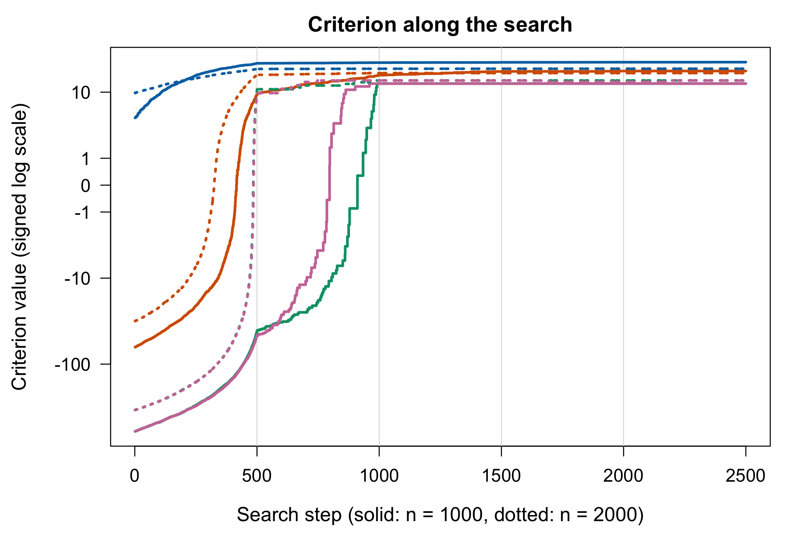

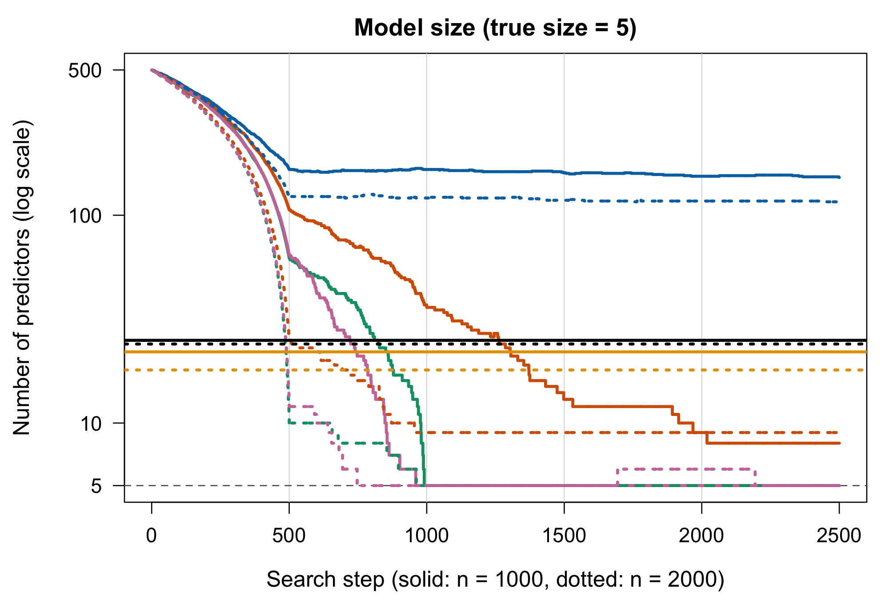

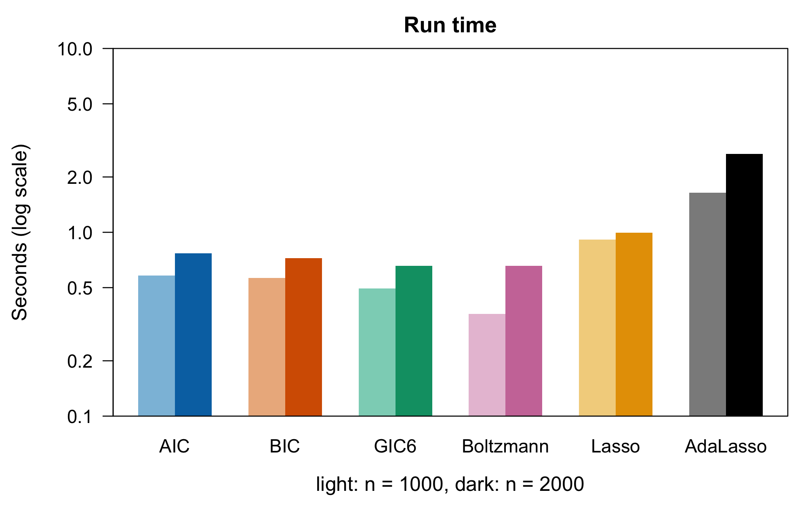


### Multivariate normal

Five responses, each with its own 5 predictors and coefficients from 10
down to 0.1. Pass the $n \times 5$ response matrix as `Y`:

```r
m <- 5
B <- matrix(0, p, m)
true_by_response <- vector("list", m)
for (i in 1:m) {
  cols <- sort(sample(p, 5))
  true_by_response[[i]] <- cols
  B[cols, i] <- seq(10, 0.1, length.out = 5)
}
Y_multi <- LP_to_Y(X, B, family = "MultivariateNormal", cov_matrix = diag(m))
true_union <- sort(unique(unlist(true_by_response)))

fits <- compare_criteria(X, Y_multi, 1:p, k = p, Nsim = 5,
                         lasso_family = "mgaussian", T = 0.05)
selection_table(fits, true_union)
#>                 size false_pos false_neg seconds
#> n1000 AIC        102        80         2    0.44
#> n1000 BIC         20         0         4    0.52
#> n1000 GIC6        19         0         5    0.36
#> n1000 Boltzmann   26         7         5    0.41
#> n1000 Lasso      129       106         1    2.27
#> n1000 AdaLasso    21         2         5    5.27
#> n2000 AIC         69        45         0    0.67
#> n2000 BIC         20         0         4    0.83
#> n2000 GIC6        19         0         5    0.71
#> n2000 Boltzmann   68        47         3    0.74
#> n2000 Lasso      131       107         0    3.83
#> n2000 AdaLasso    41        17         0    8.37
```

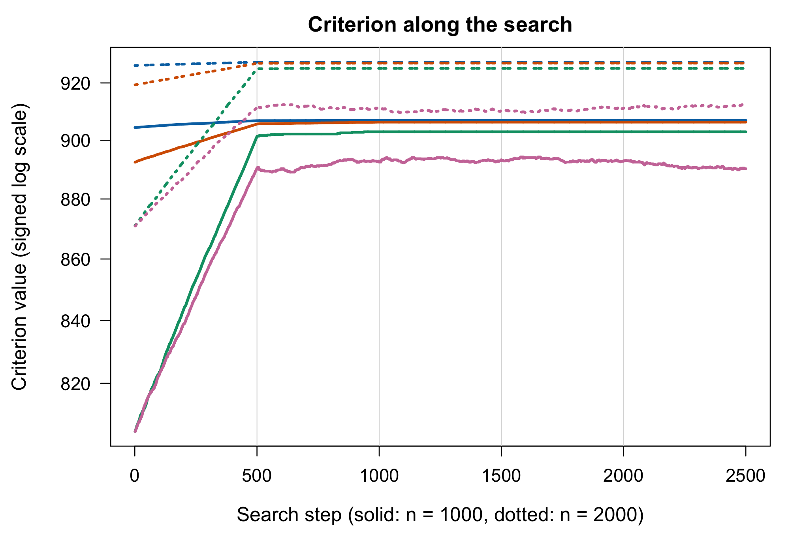

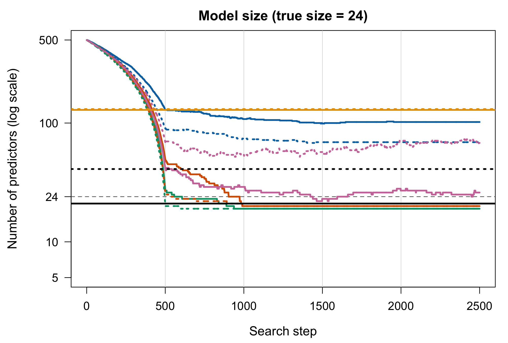

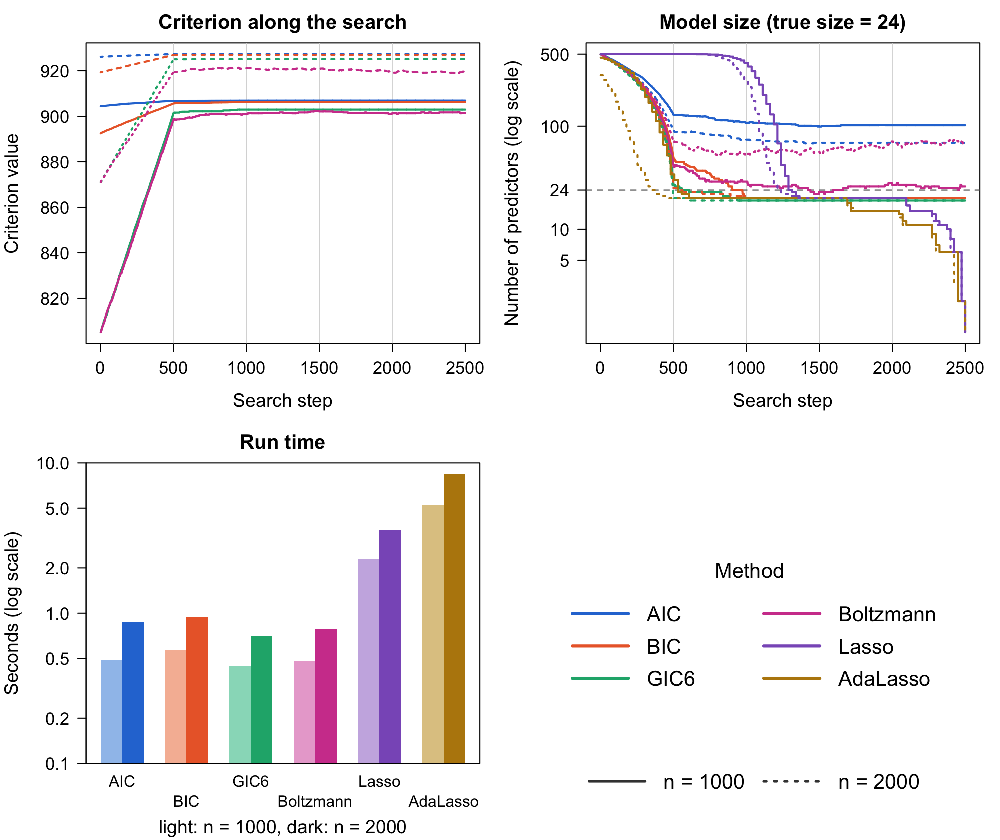


### Generalized linear models

For a non-Gaussian response, map it to the linear-predictor scale with
`Y_to_LP()`, select with `GICSelection()`, and then fit the selected model
with `Beta_estimate()`. The GLM examples reuse the design matrix `X` from
above ($n = 2000$, $p = 500$), with 5 true predictors, and start each search
from the first 10 columns.

```r
set_seeds(2)
true_cols <- c(3, 17, 42, 88, 150)
beta <- numeric(p); beta[true_cols] <- c(1, -1, 0.8, -0.8, 0.6)

# `y` is the response, `lasso_y` and `lasso_family` its form for glmnet (NULL
# to skip the lasso), and `...` the family arguments for Y_to_LP(); `T` is the
# Boltzmann temperature
compare_glm <- function(y, lasso_y, lasso_family, ..., T = 0.1)
  compare_criteria(X, Y_to_LP(y, ...), 1:10, k = 50, Nsim = 3,
                   lasso_y = lasso_y, lasso_family = lasso_family, T = T)
```

#### Poisson regression

```r
y_pois <- LP_to_Y(X, beta, family = "Poisson")
fits <- compare_glm(y_pois, y_pois, "poisson", family = "Poisson", T = 0.001)
selection_table(fits, true_cols)
#>                 size false_pos false_neg seconds
#> n1000 AIC         48        43         0    0.33
#> n1000 BIC          9         4         0    0.06
#> n1000 GIC6         5         0         0    0.07
#> n1000 Boltzmann    5         0         0    0.02
#> n1000 Lasso       29        24         0    1.91
#> n1000 AdaLasso     5         0         0    2.10
#> n2000 AIC         49        44         0    0.06
#> n2000 BIC         10         5         0    0.05
#> n2000 GIC6         5         0         0    0.11
#> n2000 Boltzmann    5         0         0    0.13
#> n2000 Lasso       51        46         0    1.47
#> n2000 AdaLasso     5         0         0    4.04

# Coefficients of the GIC6 model for n = 2000, intercept first
round(Beta_estimate(X[, last_model(fits$n2000$GIC6)], y_pois, family = "Poisson"), 2)
#> [1] -0.03  1.00 -1.01  0.79 -0.80  0.62
```

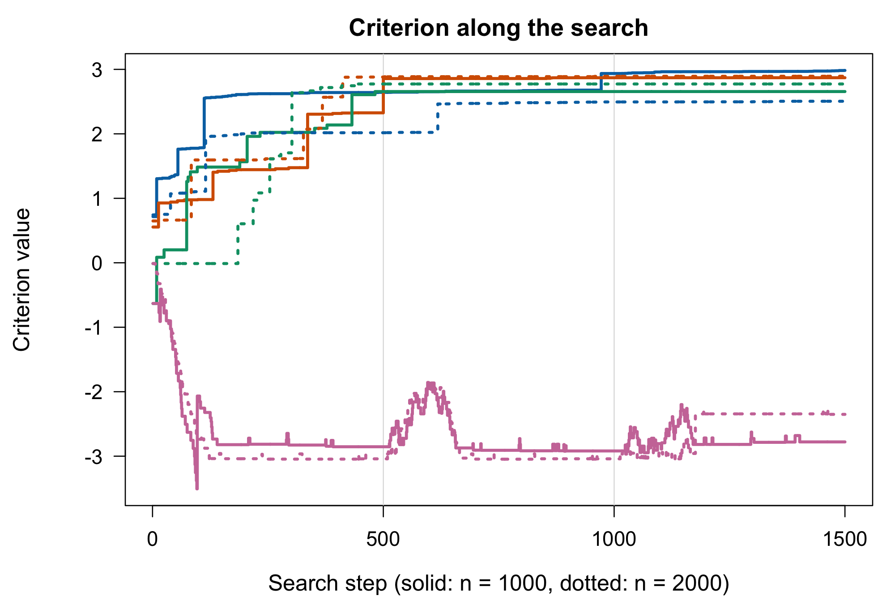

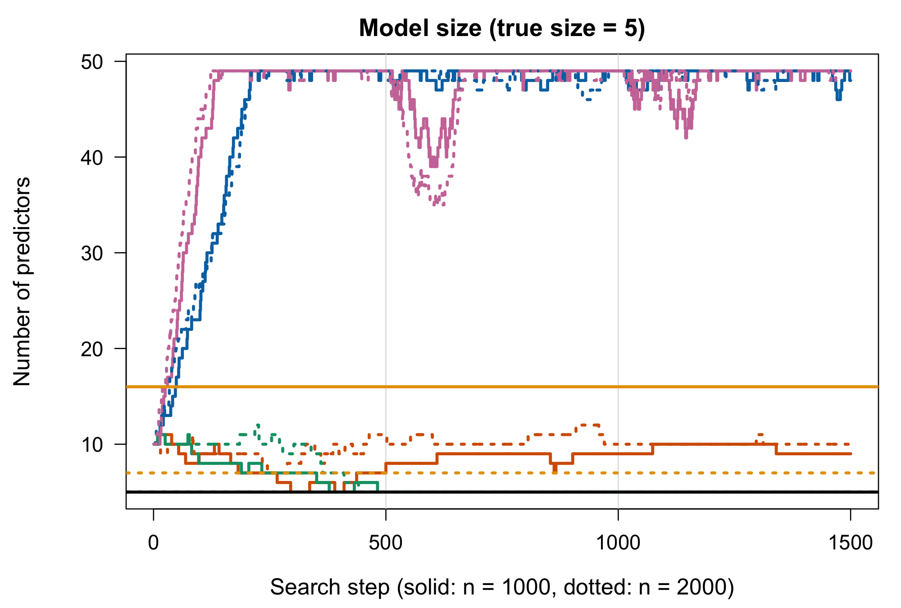

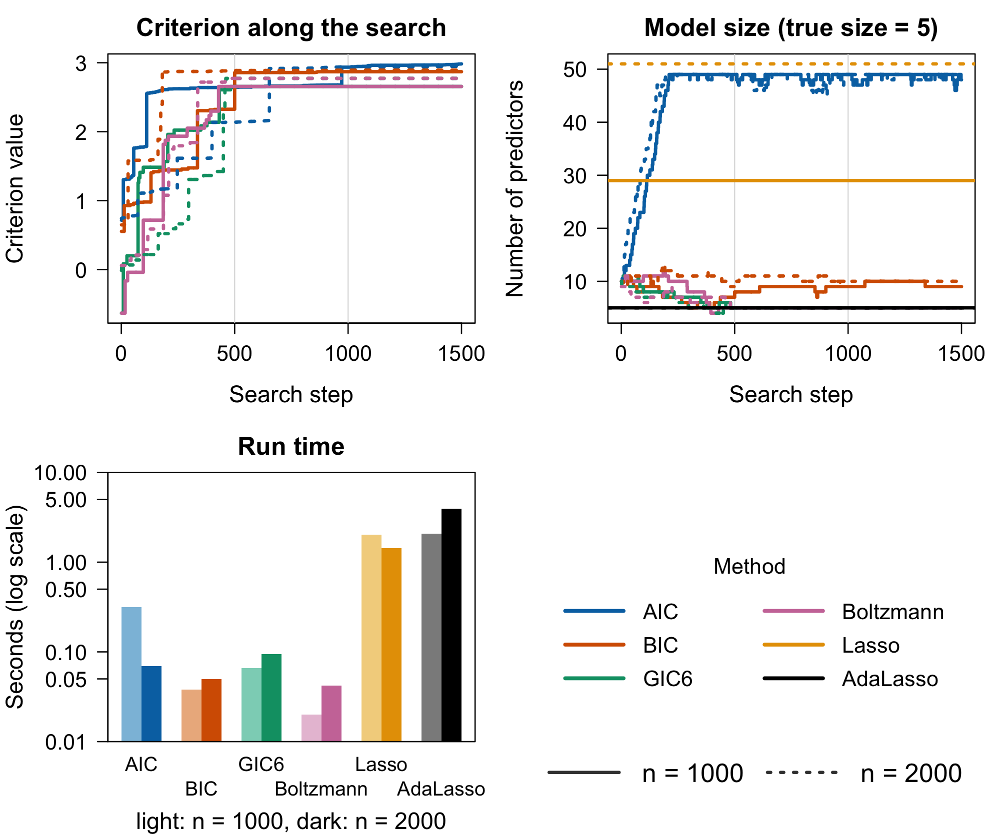

#### Binomial counts (10 trials)

```r
y_binom <- LP_to_Y(X, beta, family = "Binomial", n_trials = 10)
fits <- compare_glm(y_binom, cbind(10 - y_binom, y_binom), "binomial",
                    family = "Binomial", n_trials = 10)
selection_table(fits, true_cols)
#>                 size false_pos false_neg seconds
#> n1000 AIC         49        46         2    0.19
#> n1000 BIC          7         2         0    0.03
#> n1000 GIC6         5         0         0    0.02
#> n1000 Boltzmann    5         0         0    0.02
#> n1000 Lasso       29        24         0    1.38
#> n1000 AdaLasso    35        30         0    2.92
#> n2000 AIC         48        46         3    0.06
#> n2000 BIC          7         2         0    0.05
#> n2000 GIC6         5         0         0    0.11
#> n2000 Boltzmann    5         0         0    0.16
#> n2000 Lasso       39        34         0    1.70
#> n2000 AdaLasso     5         0         0    4.81
```

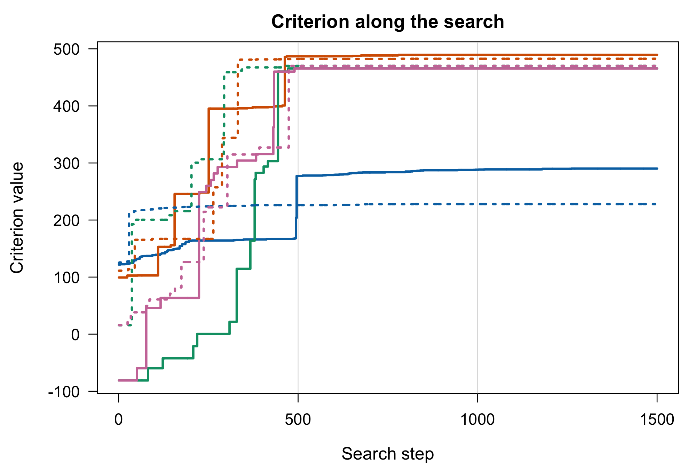

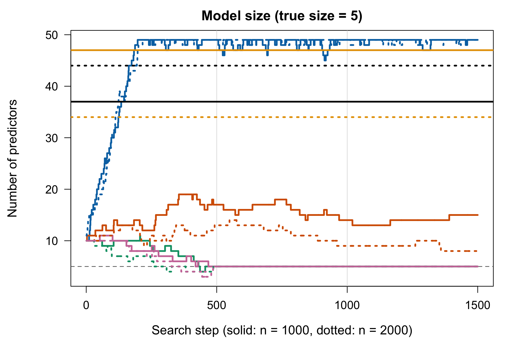

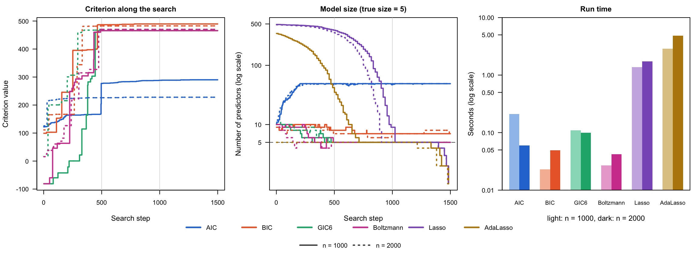

#### Multinomial (three categories)

The coefficients form a $p \times 2$ matrix, and category 3 is the baseline:

```r
B_mn <- matrix(0, p, 2)
B_mn[true_cols, 1] <- 1.5
B_mn[true_cols, 2] <- c(-1.5, 1.5, -1.5, 1.5, -1.5)
y_mn <- LP_to_Y(X, B_mn, family = "Multinomial", n_categories = 3)
fits <- compare_glm(y_mn, NULL, NULL, family = "Multinomial", n_categories = 3)
selection_table(fits, true_cols)
#>                 size false_pos false_neg seconds
#> n1000 AIC         49        47         3    0.13
#> n1000 BIC          7         2         0    0.03
#> n1000 GIC6         5         0         0    0.03
#> n1000 Boltzmann    5         0         0    0.03
#> n2000 AIC         49        45         1    0.13
#> n2000 BIC          6         1         0    0.06
#> n2000 GIC6         5         0         0    0.06
#> n2000 Boltzmann   13         8         0    0.05
```

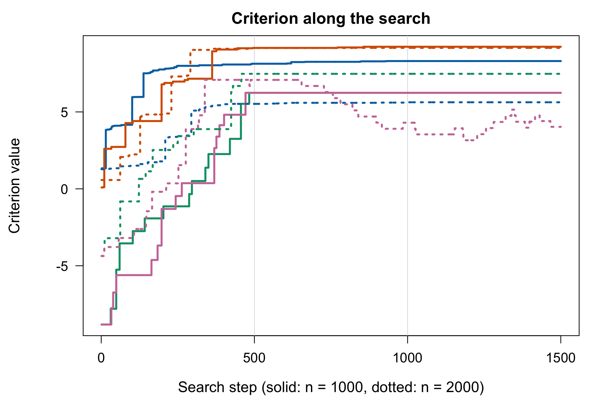

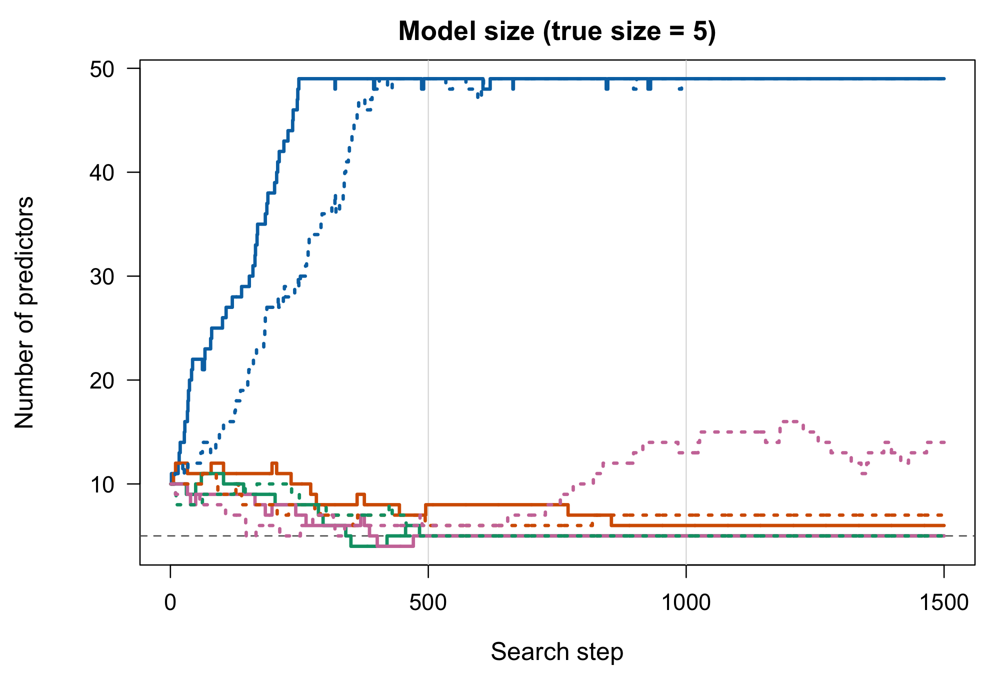

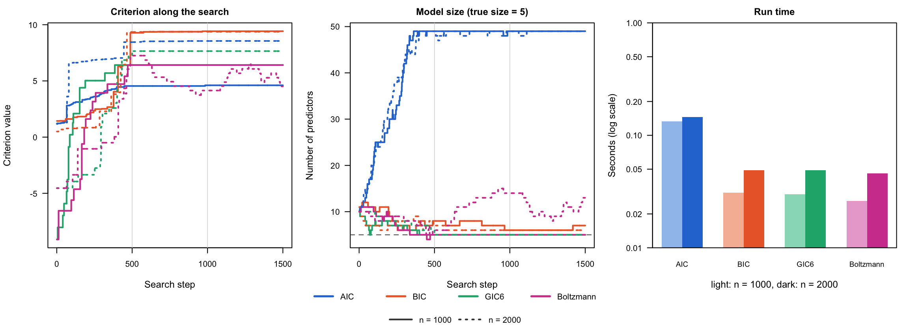

#### Cox proportional hazards

The survival times follow a Cox model, $h(t \mid x) = h_0(t)\, e^{x^\top\beta}$,
with the same $\beta$, an exponential baseline hazard $h_0(t) = 1$ and
independent exponential censoring at rate 0.3, simulated by
`LP_to_Y(family = "Cox")` ([Bender, Augustin and Blettner, 2005](https://doi.org/10.1002/sim.2059)). For the
searches, `Y_to_LP()` maps each (time, status) pair to the deviance residual of
the null Cox model ([Therneau, Grambsch and Fleming, 1990](https://doi.org/10.1093/biomet/77.1.147)), which increases with
the linear predictor. The selected model is then fitted with
`survival::coxph()`.

```r
y_cox <- LP_to_Y(X, beta, family = "Cox", censor_rate = 0.3)
mean(y_cox[, "status"] == 0)       # share of censored observations
#> [1] 0.31
y_surv <- survival::Surv(y_cox[, "time"], y_cox[, "status"])
fits <- compare_glm(y_cox, NULL, NULL, family = "Cox", T = 0.001)
selection_table(fits, true_cols)
#>                 size false_pos false_neg seconds
#> n1000 AIC         49        47         3    0.60
#> n1000 BIC          9         4         0    0.02
#> n1000 GIC6         5         0         0    0.02
#> n1000 Boltzmann    5         0         0    0.11
#> n2000 AIC         49        46         2    0.12
#> n2000 BIC         11         6         0    0.05
#> n2000 GIC6         5         0         0    0.05
#> n2000 Boltzmann    5         0         0    0.04

# Coefficients of the GIC6 model for n = 2000, from survival::coxph()
round(unname(coef(survival::coxph(y_surv ~ X[, last_model(fits$n2000$GIC6)]))), 2)
#> [1]  0.97 -0.99  0.80 -0.84  0.59
```

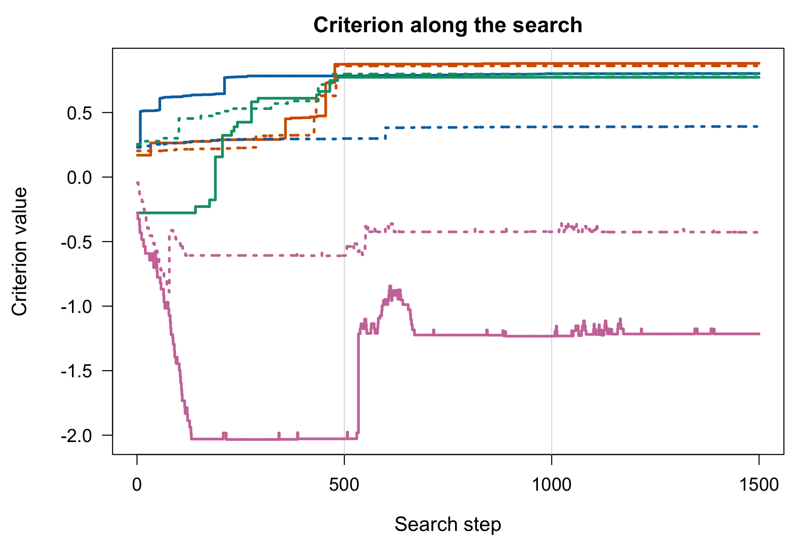

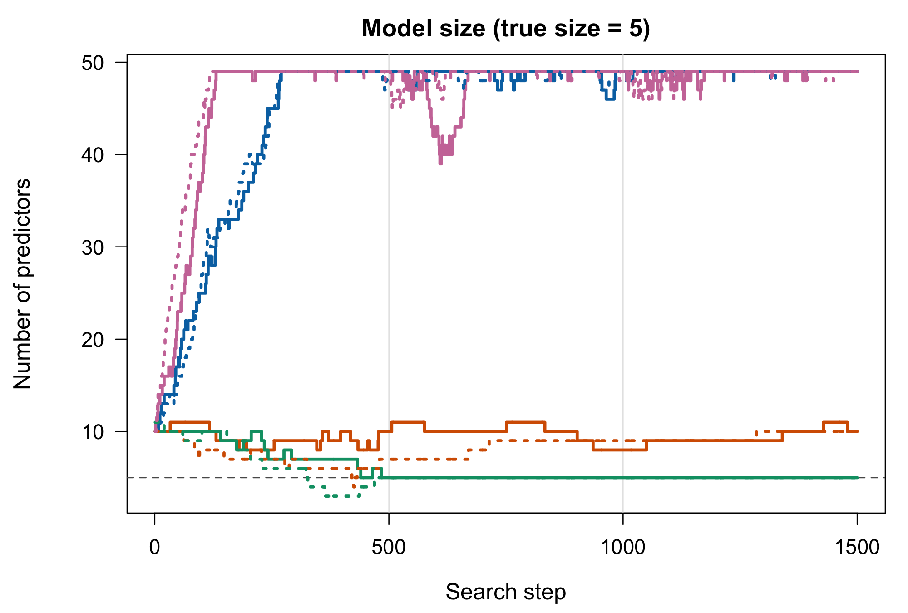


## Performance

Claude Code identified and fixed two slowdowns in the original, human-written
version of the package, which results in an 8–230× speedup of
`GICSelection()` from R, with the same variables selected. The gain grows with
the sample size: from 1.9 s to 0.23 s at $n = 1000$, $p = 200$, from 16 s to
0.52 s at $n = 1000$, $p = 500$, and from 101 s to 0.44 s at $n = 5000$,
$p = 500$.

- **The search rebuilt the $n \times n$ hat matrix for every proposed move.**
  Version 0.1.2 formed $H = X_S (X_S^\top X_S)^{-1} X_S^\top$ to score each
  add or remove, at $O(n^2 K)$ cost per move. Claude Code updated the search to
  compute every criterion from $X^\top Y$ and $(X_S^\top X_S)^{-1}$ and to score
  each move with a rank-one update, at $O(nK + K^2)$ cost. See Appendix 1 of
  the [package article](vignettes/IChop.Rmd) for the details.
- **Calls from R did not use the fast search.** `GICSelection()` and
  `GICSelectionBoltzmann()` passed the criterion to Julia as a function, which
  arrived as an R-wrapped object that the search did not recognise, so it fell
  back to refitting every candidate model and calling back into R. Claude Code
  updated the R functions to pass the criterion by name.

## References

Akaike, H. (1974). A new look at the statistical model identification.
*IEEE Transactions on Automatic Control*, 19(6), 716–723.
<https://doi.org/10.1109/TAC.1974.1100705>

Bender, R., Augustin, T. and Blettner, M. (2005). Generating survival times to
simulate Cox proportional hazards models. *Statistics in Medicine*, 24(11),
1713–1723. <https://doi.org/10.1002/sim.2059>

Bozdogan, H. (1987). Model selection and Akaike's information criterion (AIC):
The general theory and its analytical extensions. *Psychometrika*, 52(3),
345–370. <https://doi.org/10.1007/BF02294361>

Bruck, J. (1990). On the convergence properties of the Hopfield model.
*Proceedings of the IEEE*, 78(10), 1579–1585. <https://doi.org/10.1109/5.58341>

Chen, J. and Chen, Z. (2008). Extended Bayesian information criteria for model
selection with large model spaces. *Biometrika*, 95(3), 759–771.
<https://doi.org/10.1093/biomet/asn034>

Friedman, J., Hastie, T. and Tibshirani, R. (2010). Regularization paths for
generalized linear models via coordinate descent. *Journal of Statistical
Software*, 33(1), 1–22. <https://doi.org/10.18637/jss.v033.i01>

Hopfield, J. J. (1982). Neural networks and physical systems with emergent
collective computational abilities. *Proceedings of the National Academy of
Sciences*, 79(8), 2554–2558. <https://doi.org/10.1073/pnas.79.8.2554>

Hurvich, C. M. and Tsai, C.-L. (1989). Regression and time series model
selection in small samples. *Biometrika*, 76(2), 297–307.
<https://doi.org/10.1093/biomet/76.2.297>

Kim, Y., Kwon, S. and Choi, H. (2012). Consistent model selection criteria on
high dimensions. *Journal of Machine Learning Research*, 13, 1037–1057.
<https://jmlr.org/papers/v13/kim12a.html>

Schwarz, G. (1978). Estimating the dimension of a model. *The Annals of
Statistics*, 6(2), 461–464. <https://doi.org/10.1214/aos/1176344136>

Shao, J. (1997). An asymptotic theory for linear model selection.
*Statistica Sinica*, 7(2), 221–264.
<https://www3.stat.sinica.edu.tw/statistica/j7n2/j7n21/j7n21.htm>

Therneau, T. M., Grambsch, P. M. and Fleming, T. R. (1990). Martingale-based
residuals for survival models. *Biometrika*, 77(1), 147–160.
<https://doi.org/10.1093/biomet/77.1.147>

Xiao, Y. and Walker, S. (2026). Fast variable selection under $\ell_0$
regularization in high-dimensions. *Statistics and Computing*, 36(3), 100.
<https://doi.org/10.1007/s11222-026-10853-5>
