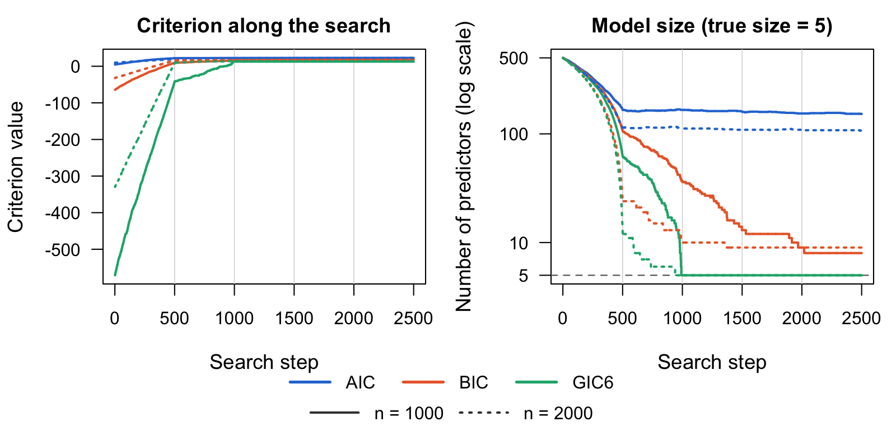
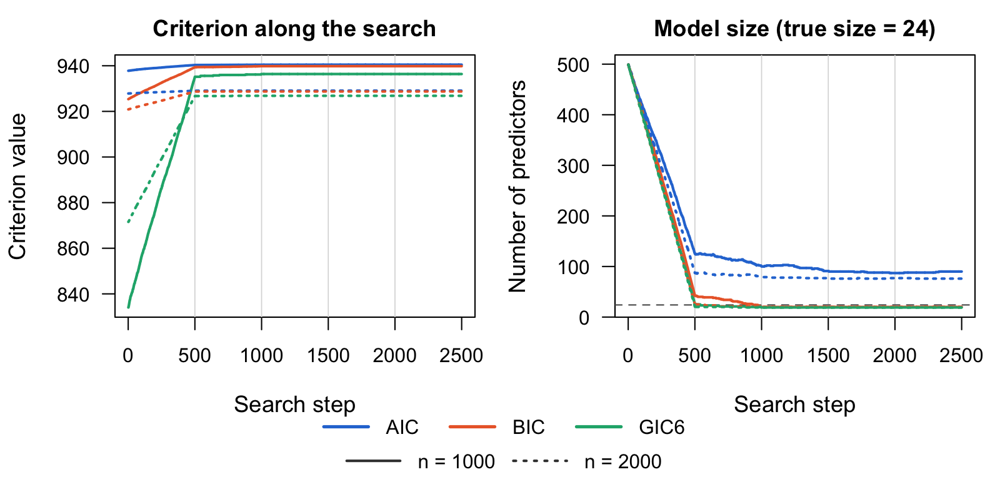
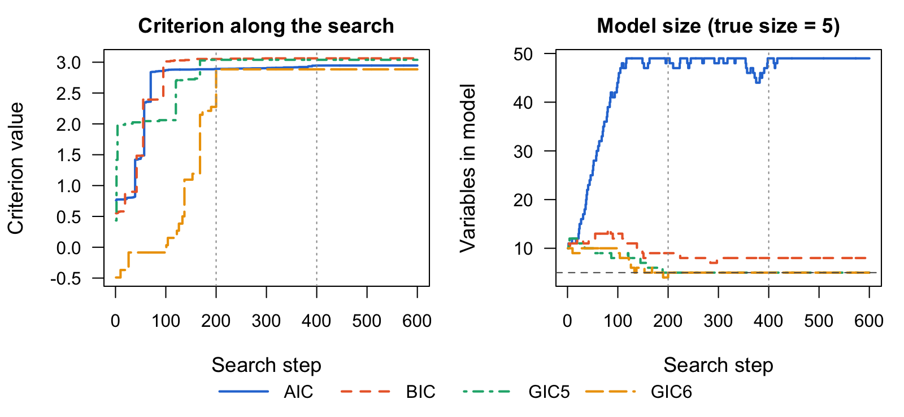
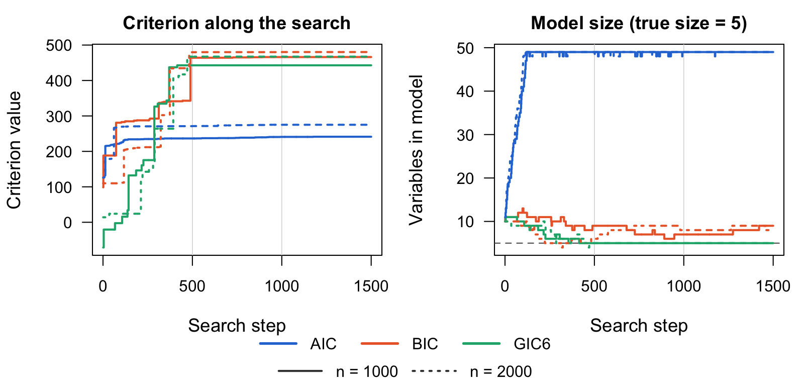
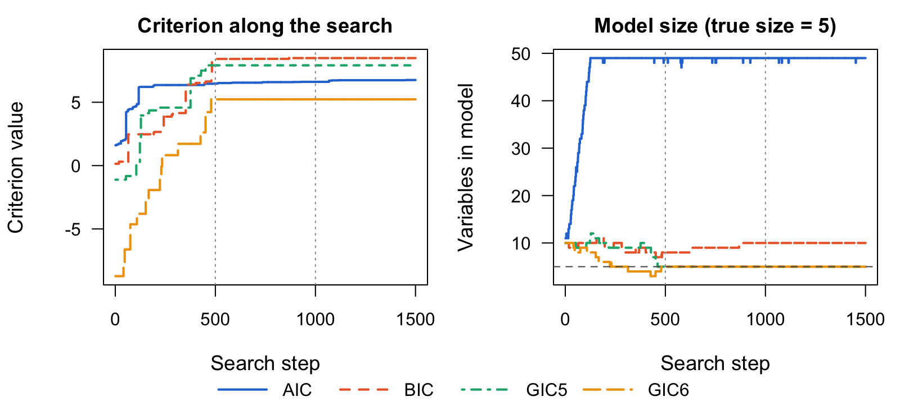

# GICHighDimension 

## Installation

Install the development version of `GICHighDimension` from GitHub:

```r
devtools::install_github("yuchenxiao95/GICHighDimension")
```

You also need Julia (≥ 1.9), which you can download from
<https://julialang.org/downloads/>. Then connect R to Julia; the first time,
also install the Julia packages the package uses:

```r
library(GICHighDimension)
setup_julia()
install_julia_packages()   # first time only
```

## Overview

GICHighDimension addresses the computational barrier of solving
$\ell_0$-penalized regression in linear models where the number of
predictors $p$ is large, in the hundreds or even the thousands, yet smaller
than the number of observations $n$. Finding the optimal solution of
$\ell_0$-penalized regression has been treated as a combinatorial problem
that requires discrete optimization and is NP-hard. This package builds on a
connection with Hopfield networks, which are used for associative memory
retrieval ([Xiao and Walker, 2026](https://doi.org/10.1007/s11222-026-10853-5)).
It makes generalized information criteria (GIC;
[Kim, Kwon and Choi, 2012](https://jmlr.org/papers/v13/kim12a.html)) for variable selection,
which are equivalent to $\ell_0$-penalized regression, computationally
feasible. The rationale is that there remains strong interest in GIC, whose
statistical properties are superior to those of $\ell_1$-based
regularization.

### The Hopfield network

A Hopfield network (Hopfield, 1982) is a model of associative memory with $p$
neurons, each connected to every other neuron by undirected edges with no
self-connections. The state $z \in \lbrace 1, -1 \rbrace^p$ evolves through a
symmetric weight matrix $W$, built from a stored pattern $z_s$ by Hebb's law,
$W = z_s^\top z_s - I$, so that $W_{ij} = W_{ji} = z_i z_j$ and $W_{ii} = 0$.
The network updates one neuron at a time,

$$
z_i(t+1) = \operatorname{sgn}\big(H_i(t)\big), \qquad
H_i(t) = \sum_{j \ne i} w_{ij} z_j(t),
$$

with $\operatorname{sgn}(H) = 1$ if $H \ge 0$ and $-1$ otherwise, cycling
through $i = 1, \dots, p$ until $z$ is stable. Each update can only lower the
energy

$$
E(z) = -z^\top W z ,
$$

and $E$ is bounded below, so the network always converges to a locally stable
state (Bruck, 1990; Rojas, 1996).

### Connection with AIC

Write the linear model with inclusion indicators $z_j \in \lbrace 0, 1 \rbrace$:

$$
y_i = \sum_{j=1}^{p} x_{ij} z_j \beta_j + \sigma \varepsilon_i ,
\qquad\text{or}\qquad
y = X D_t^p \beta + \sigma \varepsilon ,
$$

where $D_t^p = \mathrm{diag}(z_1, \dots, z_p)$ has $t$ nonzero entries, so
$X_t = X D_t^p$ holds the true predictors. For a candidate model
$X_d = X D_d^p$ with hat matrix $H_d = X_d (X_d^\top X_d)^{-1} X_d^\top$, AIC
is an asymptotically unbiased estimate of

$$
\frac{1}{n} \beta^\top X_t^\top H_d X_t \beta
= \frac{1}{n} \langle X_t \beta, X_t \beta \rangle_{H_d}
= \frac{1}{n} \langle X_t \beta, \widehat{X_t \beta} \rangle ,
$$

where $\widehat{X_t \beta} = H_d X_t \beta$. Maximizing it minimizes the
expected out-of-sample error and finds the best orthogonal projection onto
the span of $X_t \beta$, reached when $X_d = X_t$. This quantity plays the
role of a Hopfield energy: updating one indicator at a time,

$$
z_j(t+1) = \mathbf{1}\left\lbrace
\frac{1}{n} \beta^\top X_t^\top H_{d+1} X_t \beta
> \frac{1}{n} \beta^\top X_t^\top H_d X_t \beta \right\rbrace ,
$$

where $H_{d+1}$ includes $x_j$, it never decreases and is bounded above by
$\frac{1}{n} \beta^\top X_t^\top X_t \beta$. Replacing the unknown signal with
the data gives the update rule for AIC,

$$
z_j(t+1) = \mathbf{1}\left\lbrace
\frac{1}{n} y^\top H_{d+1} y - 2(d+1) \frac{\sigma^2}{n}
> \frac{1}{n} y^\top H_d y - 2d \frac{\sigma^2}{n} \right\rbrace ,
$$

and, for any GIC with penalty $p(n, d)$,

$$
z_j(t+1) = \mathbf{1}\left\lbrace
\frac{1}{n} y^\top H_{d+1} y - p(n, d+1)
> \frac{1}{n} y^\top H_d y - p(n, d) \right\rbrace .
$$

Unlike greedy forward selection or orthogonal matching pursuit, this search
keeps adding and removing variables in pursuit of the criterion's global
optimum. AIC is minimax-rate optimal but inconsistent when a true model
exists; criteria with stronger penalties achieve consistency at the expense
of underfitting (Shao, 1997; Yang, 2005; Kim et al., 2012).

A model with $d$ selected predictors scores
$\mathrm{GIC}_d = y^\top H_d y / n - p(n, d)$, where $H_d$ is its hat matrix and
$p(n, d)$ is a penalty. Table 1 of Xiao and Walker (2026) lists some
criteria in the literature with different penalties $p(n, d)$:

| Name | $p(n, d)$ | Reference |
|:--|:--|:--|
| GIC2 | $d \frac{\sigma^2}{n} d^{1/3}$ | [Kim et al. (2012)](https://jmlr.org/papers/v13/kim12a.html) |
| GIC3 | $2d \frac{\sigma^2}{n} \log d$ | [Kim et al. (2012)](https://jmlr.org/papers/v13/kim12a.html) |
| GIC4 | $2d \frac{\sigma^2}{n} (\log d + \log\log d)$ | [Kim et al. (2012)](https://jmlr.org/papers/v13/kim12a.html) |
| GIC5 | $d \frac{\sigma^2}{n} \log\log n \log d$ | [Kim et al. (2012)](https://jmlr.org/papers/v13/kim12a.html) |
| GIC6 | $d \frac{\sigma^2}{n} \log n \log d$ | [Kim et al. (2012)](https://jmlr.org/papers/v13/kim12a.html) |
| CAIC | $d \frac{\sigma^2}{n} (\log n + 1)$ | [Bozdogan (1987)](https://doi.org/10.1007/BF02294361) |
| SIC | $d \frac{\sigma^2}{n} \sqrt{n}$ | [Shao (1997)](https://www3.stat.sinica.edu.tw/statistica/j7n2/j7n21/j7n21.htm) |

## Examples

The examples below compare three criteria on the same data. In increasing
order of penalty per variable, they are AIC ($c_n = 1$), BIC ($\log n$) and
GIC6 ($\log n \log P$), where $P$ is the number of candidate
predictors. Each table reports the size, false positives and false negatives
of the selected model, and `time_s`, the time in seconds until the search
reaches the true model and stays there. If it never does, `time_s` is the
time of the whole search.

<!-- Helper functions used in the examples (hidden; run by data-raw/readme_figures.R)

```r
set_seeds <- function(seed) {
  set.seed(seed)
  JuliaCall::julia_command(sprintf("import Random; Random.seed!(%d);", seed))
}

criteria <- c(AIC = "Calculate_AIC", BIC = "Calculate_BIC", GIC6 = "Calculate_GIC6")
sample_sizes <- c(n1000 = 1000, n2000 = 2000)

# Run the search once per criterion, on the first n observations for each n
compare_criteria <- function(X, Y, init, k, Nsim) {
  lapply(sample_sizes, function(n) {
    Xn <- X[1:n, ]
    Yn <- if (is.matrix(Y)) Y[1:n, , drop = FALSE] else Y[1:n]
    lapply(criteria, function(crit)
      GICSelection(Xn, Yn, init, crit, paste0(crit, "_short"), k = k, Nsim = Nsim))
  })
}

# Compile each criterion once, so the timings exclude Julia's compilation
for (crit in criteria) for (Y0 in list(rnorm(50), matrix(rnorm(100), 50)))
  invisible(GICSelection(matrix(rnorm(500), 50), Y0, 1:2, crit,
                         paste0(crit, "_short"), k = 5))

last_model <- function(fit) sort(fit$selected_coeffs[[length(fit$selected_coeffs)]])

# Seconds until the search reaches the true model and stays there, or the time
# of the whole search if it never does
time_to_truth <- function(fit, truth) {
  hit <- vapply(fit$selected_coeffs, setequal, logical(1), truth)
  steps <- length(hit)
  if (!hit[steps]) return(fit$elapsed[steps])
  fit$elapsed[max(c(0, which(!hit))) + 1]
}

# Size, false positives, false negatives and search time of each final model
selection_table <- function(fits, truth) {
  rows <- lapply(fits, function(by_crit) t(sapply(by_crit, function(fit) {
    s <- last_model(fit)
    c(size = length(s), false_pos = length(setdiff(s, truth)),
      false_neg = length(setdiff(truth, s)),
      time_s = round(time_to_truth(fit, truth), 2))
  })))
  out <- do.call(rbind, rows)
  rownames(out) <- paste(rep(names(fits), each = length(criteria)), rownames(out))
  out
}
```

Each figure shows, for every criterion, its value and the number of selected
variables after each search step: solid lines for $n = 1000$ and dotted lines
for $n = 2000$. Light grey vertical lines mark a new pass over the
predictors, and the dashed line marks the true model size. Criteria with
larger penalties take lower values, so compare the shapes of the curves, not
their heights. The script
[`data-raw/readme_figures.R`](data-raw/readme_figures.R) runs the code in this
section and redraws the figures.
-->

All examples use the same setting. The design matrix $X$ has $n = 2000$
observations of $p = 500$ independent standard normal predictors, so the
predictor covariance is $\Sigma = I$, and only a few predictors affect the
response. Every search runs twice, on the first 1000 observations and on all
2000.

The examples below highlight some well-known statistical properties of these
criteria:

1. In linear regression, AIC is minimax-rate optimal and BIC is consistent.
   In the linear model figure, AIC (blue line) attains the minimax optimality
   at the expense of many false positives.
2. Criteria in the GIC family achieve consistency at different rates. In the
   linear model figure, GIC6 (green line) reaches the true model within two
   passes of the search, and achieves consistency at a faster rate than BIC
   (orange line).
3. Consistency is an asymptotic result. Doubling the sample size (dotted
   lines) improves the rate of consistency.

### Linear model

Here the response is $Y = X\beta + \varepsilon$ with
$\varepsilon \sim N(0, \sigma^2 I)$. Five randomly chosen coefficients equal
2 and the rest are 0, and $\sigma^2$ gives a signal-to-noise ratio of
$\beta^\top\Sigma\beta/\sigma^2 = 0.71$. Every search starts from the full
model:

```r
set_seeds(1)
n <- 2000; p <- 500
X <- matrix(rnorm(n * p), n, p)
true_cols <- sort(sample(p, 5))
beta <- numeric(p); beta[true_cols] <- 2
Y <- LP_to_Y(X, beta, family = "Normal", std = sqrt(sum(beta^2) / 0.71))

fits <- compare_criteria(X, Y, 1:p, k = p, Nsim = 5)
selection_table(fits, true_cols)
#>            size false_pos false_neg time_s
#> n1000 AIC   230       225         0  24.27
#> n1000 BIC     8         3         0   8.09
#> n1000 GIC6    5         0         0   6.35
#> n2000 AIC   197       192         0  36.08
#> n2000 BIC     9         4         0  10.60
#> n2000 GIC6    5         0         0   9.17
```




### Multivariate normal

Five responses, each with its own 5 predictors and coefficients from 10
down to 0.1. Pass the $n \times 5$ response matrix as `Y`:

```r
m <- 5
B <- matrix(0, p, m)
true_by_response <- vector("list", m)
for (i in 1:m) {
  cols <- sort(sample(p, 5))
  true_by_response[[i]] <- cols
  B[cols, i] <- seq(10, 0.1, length.out = 5)
}
Y_multi <- LP_to_Y(X, B, family = "MultivariateNormal", cov_matrix = diag(m))
true_union <- sort(unique(unlist(true_by_response)))

fits <- compare_criteria(X, Y_multi, 1:p, k = p, Nsim = 5)
selection_table(fits, true_union)
#>            size false_pos false_neg time_s
#> n1000 AIC   268       245         1  28.63
#> n1000 BIC    20         0         4   7.41
#> n1000 GIC6   19         0         5   6.85
#> n2000 AIC   232       208         0  42.81
#> n2000 BIC    20         0         4  12.57
#> n2000 GIC6   19         0         5  12.87
```




### Generalized linear models

For a non-Gaussian response, map it to the linear-predictor scale with
`Y_to_LP()`, select with `GICSelection()`, and then fit the selected model
with `Beta_estimate()`. The GLM examples reuse the design matrix `X` from
above ($n = 2000$, $p = 500$), with 5 true predictors, and start each search
from the first 10 columns.

```r
set_seeds(2)
true_cols <- c(3, 17, 42, 88, 150)
beta <- numeric(p); beta[true_cols] <- c(1, -1, 0.8, -0.8, 0.6)

compare_glm <- function(Y, ...) compare_criteria(X, Y_to_LP(Y, ...), 1:10, k = 50, Nsim = 3)
```

#### Poisson regression

```r
y_pois <- LP_to_Y(X, beta, family = "Poisson")
fits <- compare_glm(y_pois, family = "Poisson")
selection_table(fits, true_cols)
#>            size false_pos false_neg time_s
#> n1000 AIC    49        45         1   0.37
#> n1000 BIC     9         4         0   0.47
#> n1000 GIC6    5         0         0   0.24
#> n2000 AIC    49        45         1   0.78
#> n2000 BIC    10         5         0   1.03
#> n2000 GIC6    5         0         0   0.39

# Coefficients of the GIC6 model for n = 2000, intercept first
round(Beta_estimate(X[, last_model(fits$n2000$GIC6)], y_pois, family = "Poisson"), 2)
#> [1] -0.03  1.00 -1.01  0.79 -0.80  0.62
```



#### Binomial counts (10 trials)

```r
y_binom <- LP_to_Y(X, beta, family = "Binomial", n_trials = 10)
fits <- compare_glm(y_binom, family = "Binomial", n_trials = 10)
selection_table(fits, true_cols)
#>            size false_pos false_neg time_s
#> n1000 AIC    49        47         3   0.46
#> n1000 BIC     9         4         0   0.56
#> n1000 GIC6    5         0         0   0.17
#> n2000 AIC    49        46         2   0.69
#> n2000 BIC     8         3         0   0.84
#> n2000 GIC6    5         0         0   0.24
```



#### Multinomial (three categories)

The coefficients form a $p \times 2$ matrix, and category 3 is the baseline:

```r
B_mn <- matrix(0, p, 2)
B_mn[true_cols, 1] <- 1.5
B_mn[true_cols, 2] <- c(-1.5, 1.5, -1.5, 1.5, -1.5)
y_mn <- LP_to_Y(X, B_mn, family = "Multinomial", n_categories = 3)
fits <- compare_glm(y_mn, family = "Multinomial", n_categories = 3)
selection_table(fits, true_cols)
#>            size false_pos false_neg time_s
#> n1000 AIC    49        47         3   0.34
#> n1000 BIC     9         4         0   0.49
#> n1000 GIC6    5         0         0   0.15
#> n2000 AIC    49        48         4   0.82
#> n2000 BIC     8         3         0   0.84
#> n2000 GIC6    5         0         0   0.26
```


