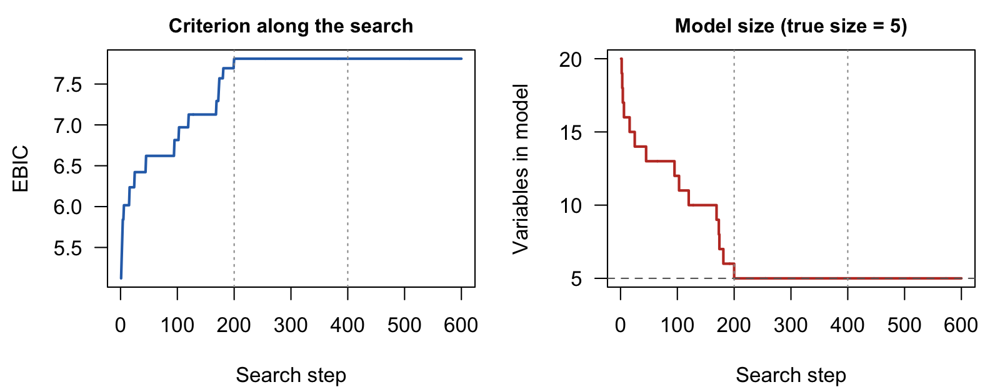

# GICHighDimension 

GICHighDimension is an R package for variable selection in high-dimensional
regression. It searches over subsets of predictors for the one that maximizes
a generalized information criterion (GIC), such as AIC, BIC, EBIC or GIC2–GIC6,
using a fast Hopfield-network style coordinate search. Univariate and
multivariate responses are supported, along with the common generalized
linear model families.

The search engine is written in [Julia](https://julialang.org/) and called from
R through `JuliaCall`. It never forms the $n \times n$ hat matrix: every
proposed move is scored with a rank-one update, so a pass over thousands of
candidate predictors takes milliseconds. The method is described in
[Xiao and Walker (2026)](https://doi.org/10.1007/s11222-026-10853-5).

## Installation

Install the development version of `GICHighDimension` from GitHub:

```r
devtools::install_github("yuchenxiao95/GICHighDimension")
```

You also need Julia (≥ 1.9), which you can download from
<https://julialang.org/downloads/>. Then connect R to Julia; the first time,
also install the Julia packages the package uses:

```r
library(GICHighDimension)
setup_julia()
install_julia_packages()   # first time only
```

## Example

Simulate data with 200 candidate predictors, 5 of them active, and select
variables with EBIC:

```r
set.seed(1)
n <- 300; p <- 200
X <- matrix(rnorm(n * p), n, p)
beta <- c(2, -1.5, 1, 1, -1, rep(0, p - 5))
Y <- LP_to_Y(X, beta, family = "Normal")

fit <- GICSelection(X, Y,
  Initial_Column      = 1:20,
  Calculate_GIC       = "Calculate_EBIC",
  Calculate_GIC_short = "Calculate_EBIC_short",
  k = 50, Nsim = 3
)

sort(fit$selected_coeffs[[length(fit$selected_coeffs)]])
#> [1] 1 2 3 4 5
```

The search starts from 20 variables, removes the 15 noise variables and keeps
the 5 true ones within its first pass over the predictors (each dotted line
marks a new pass):



For the available criteria and response families, see the Get started
article, `vignette("get-started")`.

## More examples

The examples below are condensed from the
[Examples article](https://yuchenxiao95.github.io/GICHighDimension/articles/examples.html)
(`vignette("examples")`), which explains each step. Data simulation and the
search order use Julia's random number generator, which `set.seed()` does not
control, so seed both to reproduce the output shown:

```r
set_seeds <- function(seed) {
  set.seed(seed)
  JuliaCall::julia_command(sprintf("import Random; Random.seed!(%d);", seed))
}
```

### Linear model with 500 candidate predictors

Take $n = 1000$ and $p = 500$, with 5 true coefficients equal to 2 and the
noise set for a signal-to-noise ratio of $\beta^\top\Sigma\beta/\sigma^2 = 0.71$.
Start BIC from the full model:

```r
set_seeds(1)
n <- 1000; p <- 500
X <- matrix(rnorm(n * p), n, p)
true_cols <- sort(sample(p, 5))
beta <- numeric(p); beta[true_cols] <- 2
Y <- LP_to_Y(X, beta, family = "Normal", std = sqrt(sum(beta^2) / 0.71))

fit <- GICSelection(X, Y, 1:p, "Calculate_BIC", "Calculate_BIC_short",
                    k = p, Nsim = 5)
selected <- sort(fit$selected_coeffs[[length(fit$selected_coeffs)]])
setdiff(selected, true_cols)   # false positives
#> [1] 266
setdiff(true_cols, selected)   # false negatives
#> integer(0)
```

BIC finds all 5 true predictors and one noise variable. EBIC penalizes the
number of candidate models and selects exactly the true 5. Start EBIC from a
small model: its penalty is 0 for the full model, so a search started there
does not move.

```r
fit_ebic <- GICSelection(X, Y, 1:10, "Calculate_EBIC", "Calculate_EBIC_short",
                         k = 50, Nsim = 5)
sort(fit_ebic$selected_coeffs[[length(fit_ebic$selected_coeffs)]])
#> [1]  21 153 270 375 479
```

### Several responses (multivariate normal)

Five responses, each with its own 5 predictors and coefficients from 10
down to 0.1. Pass the $n \times 5$ response matrix as `Y`:

```r
m <- 5
B <- matrix(0, p, m)
true_by_response <- vector("list", m)
for (i in 1:m) {
  cols <- sort(sample(p, 5))
  true_by_response[[i]] <- cols
  B[cols, i] <- seq(10, 0.1, length.out = 5)
}
Y_multi <- LP_to_Y(X, B, family = "MultivariateNormal", cov_matrix = diag(m))

fit_multi <- GICSelection(X, Y_multi, 1:p, "Calculate_SIC", "Calculate_SIC_short",
                          k = p, Nsim = 5)
selected_multi <- sort(fit_multi$selected_coeffs[[length(fit_multi$selected_coeffs)]])
true_union     <- sort(unique(unlist(true_by_response)))
setdiff(selected_multi, true_union)   # false positives
#> integer(0)
setdiff(true_union, selected_multi)   # false negatives
#> [1] 313 365 415 463 476
```

The 5 predictors that are missed are those with coefficient 0.1, one per
response. Every predictor with a coefficient of 2.575 or more is found.

### Generalized linear models

For a non-Gaussian response, map it to the linear-predictor scale with
`Y_to_LP()`, select with `GICSelection()`, and then fit the selected model
with `Beta_estimate()`:

```r
set_seeds(2)
n <- 1000; p <- 200
X <- matrix(rnorm(n * p), n, p)
true_cols <- c(3, 17, 42, 88, 150)
beta <- numeric(p); beta[true_cols] <- c(1, -1, 0.8, -0.8, 0.6)

select_glm <- function(Y, ...) {
  fit <- GICSelection(X, Y_to_LP(Y, ...), 1:10,
                      "Calculate_EBIC", "Calculate_EBIC_short", k = 50, Nsim = 3)
  sort(fit$selected_coeffs[[length(fit$selected_coeffs)]])
}

# Logistic regression
y_bern <- LP_to_Y(X, beta, family = "Bernoulli")
sel <- select_glm(y_bern, family = "Bernoulli")
sel
#> [1]   3  17  42  88 150
round(Beta_estimate(X[, sel], y_bern, family = "Bernoulli"), 2)   # intercept first
#> [1] -0.07  0.81 -1.05  0.78 -0.85  0.59

# Binomial counts out of 10 trials
y_binom <- LP_to_Y(X, beta, family = "Binomial", n_trials = 10)
select_glm(y_binom, family = "Binomial", n_trials = 10)
#> [1]   3  17  42  88 150

# Poisson regression
y_pois <- LP_to_Y(X, beta, family = "Poisson")
sel <- select_glm(y_pois, family = "Poisson")
round(Beta_estimate(X[, sel], y_pois, family = "Poisson"), 2)
#> [1] -0.05  1.03 -1.00  0.82 -0.81  0.60

# Overdispersed counts (negative binomial, size 2)
y_nb <- LP_to_Y(X, beta, family = "NegativeBinomial", theta = 2)
select_glm(y_nb, family = "NegativeBinomial")
#> [1]   3  17  42  88 150

# Positive continuous responses (gamma and inverse Gaussian, log link)
y_gamma <- LP_to_Y(X, beta, family = "Gamma", shape = 2)
select_glm(y_gamma, family = "Gamma")
#> [1]   3  17  42  88 150
y_ig <- LP_to_Y(X, beta, family = "InverseGaussian", shape = 2)
select_glm(y_ig, family = "InverseGaussian")
#> [1]   3  17  42  88 150

# Three-category multinomial (p x 2 coefficient matrix; category 3 is the baseline)
B_mn <- matrix(0, p, 2)
B_mn[true_cols, 1] <- 1.5
B_mn[true_cols, 2] <- c(-1.5, 1.5, -1.5, 1.5, -1.5)
y_mn <- LP_to_Y(X, B_mn, family = "Multinomial", n_categories = 3)
select_glm(y_mn, family = "Multinomial", n_categories = 3)
#> [1]   3  17  42  88 150
```

Each GLM search finds exactly the 5 true predictors in under a second.
