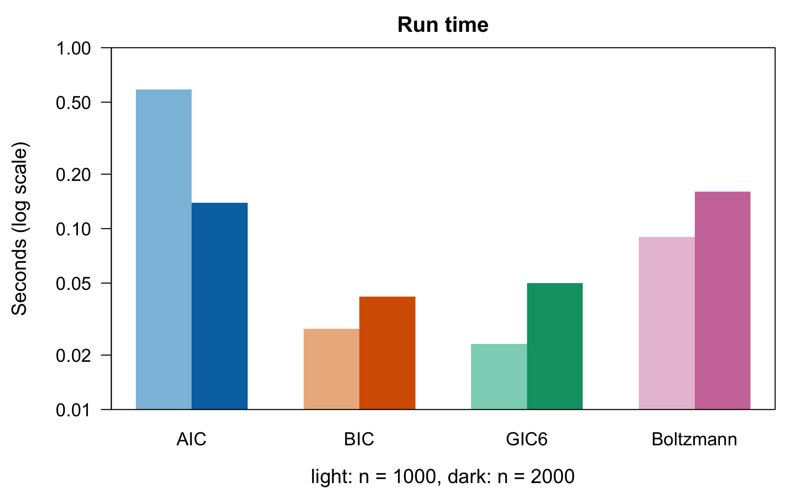

# An Introduction to IChop

## Introduction

`IChop` is a package that selects variables in high-dimensional
regression by maximizing a generalized information criterion (GIC).
Finding the best subset of variables under an \ell_0 penalty is a
combinatorial problem, and an exhaustive search is out of reach once
there are more than a few dozen candidate predictors. The package
instead runs a Hopfield-network style coordinate search (Xiao and
Walker, 2026): it visits the candidate variables in random order,
proposes adding a variable that is out of the model or removing one that
is in it, and keeps the move when the criterion improves. The stable
states of this search are local optima of the criterion, and in practice
it finds the true model quickly when one exists.

Every criterion in the package has the form \mathrm{GIC} = \frac{Y^\top
H Y}{n} - \frac{K\\\hat\sigma^2}{n}\\c_n , where H is the hat matrix of
the selected columns, K the number of selected variables, \hat\sigma^2
the residual variance, and c_n the penalty per variable. AIC (c_n = 2)
and BIC (c_n = \log n) are special cases; the GIC family of Kim, Kwon
and Choi (2012) uses penalties that grow with the number of candidate
predictors p, which is what makes selection consistent in high
dimensions. The package implements thirteen criteria, listed in
[Choosing a criterion](#choosing-a-criterion).

The search itself runs in Julia, which R calls through the `JuliaCall`
package. It never forms the n \times n hat matrix and scores each
proposed move with a rank-one update, so a pass over thousands of
predictors takes seconds ([Appendix
1](#appendix-1-how-the-search-stays-fast)).

The package handles Gaussian responses, multivariate Gaussian responses
(several outcomes sharing the same predictors), and generalized linear
models through a transformation to the linear-predictor scale. This
vignette works through each case in turn, and [Appendix
2](#appendix-2-comparison-with-other-packages) compares the search with
the lasso and adaptive lasso from `glmnet` on larger simulations.

The same methods are available as a Julia package,
[IChop.jl](https://github.com/yuchenxiao95/IChop.jl).

## Installation

Install the development version from GitHub:

``` r

devtools::install_github("yuchenxiao95/IChop")
```

The search needs Julia (≥ 1.9), which you can download from
<https://julialang.org/downloads/>. Then connect R to Julia; the first
time, also install the Julia packages that `IChop` uses:

``` r

library(IChop)
setup_julia()               # or setup_julia("/path/to/julia/bin")
install_julia_packages()    # first time only
```

The first call in a session also compiles the Julia code, which adds a
few seconds once.

## Quick Start

This section gives a quick overview of the package. We simulate a sparse
linear model with n = 300 observations and p = 30 candidate predictors,
of which the first three are active. The simulation and the random
visiting order of the search both use Julia’s random number generator,
which [`set.seed()`](https://rdrr.io/r/base/Random.html) does not
control, so we seed both:

``` r

set_seeds <- function(seed) {
  set.seed(seed)
  JuliaCall::julia_command(sprintf("import Random; Random.seed!(%d);", seed))
}

set_seeds(123)
n <- 300; p <- 30
X <- matrix(rnorm(n * p), n, p)
beta <- c(2, -1.5, 1, rep(0, p - 3))
Y <- LP_to_Y(X, beta, family = "Normal")
```

We run the search with EBIC, starting from the first five variables:

``` r

fit <- GICSelection(
  X, Y,
  Initial_Column      = 1:5,
  Calculate_GIC       = "Calculate_EBIC",
  Calculate_GIC_short = "Calculate_EBIC_short",
  k    = 15,     # skip models with 15 or more variables
  Nsim = 3       # passes over the variables
)
```

`Calculate_GIC` names the criterion. `Calculate_GIC_short` must name the
matching `_short` function; it is kept for backward compatibility and
the search does not use it.

`fit` records the state of the search after each of its `Nsim * p = 90`
steps:

``` r

str(fit, max.level = 1, vec.len = 3)
#> List of 3
#>  $ GIC_values     : num [1:90] 6.82 6.82 6.82 6.82 ...
#>  $ selected_coeffs:List of 90
#>  $ elapsed        : num [1:90] 0.0404 0.0404 0.0404 0.0404 ...
```

`GIC_values` is the criterion value, `selected_coeffs` the selected
variables, and `elapsed` the time in seconds since the search started.
The last element of `selected_coeffs` is the selected model, and here it
is exactly the true one:

``` r

selected <- sort(fit$selected_coeffs[[length(fit$selected_coeffs)]])
selected
#> [1] 1 2 3
```

`plot(fit$GIC_values, type = "l")` shows the search converging. Finally,
[`Beta_estimate()`](https://yuchenxiao95.github.io/IChop/reference/Beta_estimate.md)
fits the selected model, with the intercept first:

``` r

round(Beta_estimate(X[, selected, drop = FALSE], Y, family = "Normal"), 3)
#> [1] -0.057  2.044 -1.424  0.995
```

## Linear Regression: `family = "Normal"`

The Gaussian linear model is the default case. The response is a numeric
vector, and
[`GICSelection()`](https://yuchenxiao95.github.io/IChop/reference/GICSelection.md)
uses it directly. This section covers the choice of criterion, the
arguments of the search, and the Boltzmann variant of the search. We
keep using `X` and `Y` from the [Quick Start](#quick-start).

### Choosing a criterion

The criteria differ only in the penalty c_n:

| Function | Criterion | Penalty c_n | Reference |
|:---|:---|:---|:---|
| `Calculate_AIC` | AIC | 2 | Akaike (1974) |
| `Calculate_BIC` | BIC | \log n | Schwarz (1978) |
| `Calculate_CAIC` | Consistent AIC | 1 + \log n | Bozdogan (1987) |
| `Calculate_CAICF` | Consistent AIC with Fisher information | 1 + \log n + \log\det(X_S^\top X_S / \hat\sigma^2) / K | Bozdogan (1987) |
| `Calculate_SIC` | Square-root IC | \sqrt n | Shao (1997) |
| `Calculate_GIC2` | GIC\_2 | p^{1/3} | Kim, Kwon and Choi (2012) |
| `Calculate_GIC3` | GIC\_3 | 2 \log p | Kim, Kwon and Choi (2012) |
| `Calculate_GIC4` | GIC\_4 | 2(\log p + \log\log p) | Kim, Kwon and Choi (2012) |
| `Calculate_GIC5` | GIC\_5 | \log\log n \\ \log p | Kim, Kwon and Choi (2012) |
| `Calculate_GIC6` | GIC\_6 | \log n \\ \log p | Kim, Kwon and Choi (2012) |
| `Calculate_EBIC` | Extended BIC | \log n + \gamma \log \binom{p}{K}, \gamma = 0.6 by default | Chen and Chen (2008) |

Here p is the number of candidate variables and X_S the selected
columns; CAICF supports vector responses only. Two criteria use slightly
different forms (see
[`?information_criteria`](https://yuchenxiao95.github.io/IChop/reference/information_criteria.md)):
`Calculate_AICc`, the small-sample corrected AIC (Hurvich and Tsai,
1989), and `Calculate_AttIC`, an attention-weighted criterion specific
to this package.

AIC is minimax-rate optimal for prediction but is not consistent when a
true model exists: its penalty is too small to rule out spurious
variables. The criteria with larger penalties are consistent. On the
Quick Start data, AIC keeps four noise variables, while the others
recover the true model:

``` r

criteria <- c("Calculate_AIC", "Calculate_BIC", "Calculate_SIC",
              "Calculate_GIC6", "Calculate_EBIC")
sapply(criteria, function(crit) {
  JuliaCall::julia_command("Random.seed!(1);")
  f <- GICSelection(X, Y, 1:5, crit, paste0(crit, "_short"), k = 15, Nsim = 3)
  paste(sort(f$selected_coeffs[[length(f$selected_coeffs)]]), collapse = " ")
})
#>      Calculate_AIC      Calculate_BIC      Calculate_SIC     Calculate_GIC6 
#> "1 2 3 8 17 24 25"            "1 2 3"            "1 2 3"            "1 2 3" 
#>     Calculate_EBIC 
#>            "1 2 3" 
```

Each criterion can also score a single model directly. For example,
`Calculate_EBIC(Y, X[, 1:3])` returns a list with `CriterionValue`, the
value of EBIC for the model with the first three variables, and
`InverseMatrix`, (X_S^\top X_S)^{-1}.

### Commonly used function arguments

[`GICSelection()`](https://yuchenxiao95.github.io/IChop/reference/GICSelection.md)
has a small number of arguments, and most problems need only the
following:

- `Initial_Column`: the variables in the starting model. Starting from
  all variables (`1:p`) works well when p is small relative to n; for
  larger p, start from a handful of variables.

- `k`: the model-size cap. A move that would give a model with `k` or
  more variables is skipped, and models never exceed n - 1 variables, so
  the selected model has at most `min(k, n) - 1` variables. Set `k` well
  above the model size you expect.

- `Nsim`: the number of passes over the variables, each in a new random
  order. The search usually settles within two or three passes; more
  passes cost little because a pass that changes nothing is cheap.

- `gamma`: the EBIC tuning constant \gamma (default 0.6). Larger values
  penalize large models more. Other criteria ignore it.

### Boltzmann search

The coordinate search is greedy: it only accepts moves that increase the
criterion, so it stops at the first local optimum it reaches.
[`GICSelectionBoltzmann()`](https://yuchenxiao95.github.io/IChop/reference/GICSelectionBoltzmann.md)
runs the same search but also accepts a move that lowers the criterion
by \Delta, with probability 1/(1 + e^{\Delta/T}), so it can leave a
local optimum. The temperature T controls how often this happens.

The size of a typical change in the criterion depends on the data and
the criterion, so the right T differs between problems. On the Quick
Start data, the default T = 0.1 is far too permissive, and the search
ends with eleven variables; T = 0.001 recovers the true model:

``` r

set_seeds(123)
fb <- GICSelectionBoltzmann(X, Y, 1:5, "Calculate_EBIC", "Calculate_EBIC_short",
                            T = 0.1, Nsim = 3, k = 15)
sort(fb$GIC_coeff[[length(fb$GIC_coeff)]])
#>  [1]  1  2  3  4  7 13 14 16 17 20 29

set_seeds(123)
fb <- GICSelectionBoltzmann(X, Y, 1:5, "Calculate_EBIC", "Calculate_EBIC_short",
                            T = 0.001, Nsim = 3, k = 15)
sort(fb$GIC_coeff[[length(fb$GIC_coeff)]])
#> [1] 1 2 3
```

[`GICSelectionBoltzmann()`](https://yuchenxiao95.github.io/IChop/reference/GICSelectionBoltzmann.md)
returns the criterion values in `GIC_list` and the selected variables
after each step in `GIC_coeff`.

## Multivariate Regression: `family = "MultivariateNormal"`

When several responses share the same predictors, pass them as an n
\times q matrix. The criterion is then the trace of a q \times q matrix,
and a variable is selected if it improves the fit for the responses
jointly. Here three responses depend on five of the predictors, with
each response using a different subset:

``` r

set_seeds(1)
B <- matrix(0, p, 3)
B[1:3, 1] <- 1
B[c(2, 4), 2] <- -1
B[5, 3] <- 1.5
Y_multi <- LP_to_Y(X, B, family = "MultivariateNormal", cov_matrix = diag(3))
dim(Y_multi)
#> [1] 300   3

fit_multi <- GICSelection(X, Y_multi, 1:5, "Calculate_EBIC", "Calculate_EBIC_short",
                          k = 15, Nsim = 3)
selected <- sort(fit_multi$selected_coeffs[[length(fit_multi$selected_coeffs)]])
selected
#> [1] 1 2 3 4 5
```

The search selects the union of the active variables.
[`Beta_estimate()`](https://yuchenxiao95.github.io/IChop/reference/Beta_estimate.md)
then returns one column of coefficients per response, with the intercept
in the first row:

``` r

round(Beta_estimate(X[, selected, drop = FALSE], Y_multi,
                    family = "MultivariateNormal"), 2)
#>      [,1]  [,2]  [,3]
#> [1,] 0.02  0.03  0.03
#> [2,] 1.09 -0.05 -0.04
#> [3,] 1.02 -0.99 -0.14
#> [4,] 1.07  0.04  0.04
#> [5,] 0.02 -0.97 -0.03
#> [6,] 0.13  0.00  1.56
```

## Poisson Regression: `family = "Poisson"`

For a non-Gaussian response, the search works on the linear-predictor
scale.
[`Y_to_LP()`](https://yuchenxiao95.github.io/IChop/reference/Y_to_LP.md)
maps the response to that scale with the family’s link, the search
selects the variables, and
[`Beta_estimate()`](https://yuchenxiao95.github.io/IChop/reference/Beta_estimate.md)
fits the GLM on the selected variables. We simulate counts with three
active predictors:

``` r

beta_glm <- c(1, -1, 0.5, rep(0, p - 3))

set_seeds(2)
y_pois <- LP_to_Y(X, beta_glm, family = "Poisson")
head(y_pois)
#> [1]  1  0 13  0  2  2

fit_pois <- GICSelection(X, Y_to_LP(y_pois, family = "Poisson"), 1:5,
                         "Calculate_EBIC", "Calculate_EBIC_short", k = 15, Nsim = 3)
selected <- sort(fit_pois$selected_coeffs[[length(fit_pois$selected_coeffs)]])
selected
#> [1] 1 2 3
```

[`Beta_estimate()`](https://yuchenxiao95.github.io/IChop/reference/Beta_estimate.md)
fits the Poisson model with the log link on the original counts, not on
the transformed response:

``` r

round(Beta_estimate(X[, selected, drop = FALSE], y_pois, family = "Poisson"), 3)
#> [1]  0.039  0.980 -0.968  0.559
```

## Logistic Regression: `family = "Bernoulli"` and `family = "Binomial"`

Binary responses use `family = "Bernoulli"` and the logit link:

``` r

set_seeds(3)
y_bern <- LP_to_Y(X, beta_glm, family = "Bernoulli")
table(y_bern)
#> y_bern
#>   0   1
#> 135 165

fit_bern <- GICSelection(X, Y_to_LP(y_bern, family = "Bernoulli"), 1:5,
                         "Calculate_EBIC", "Calculate_EBIC_short", k = 15, Nsim = 3)
selected <- sort(fit_bern$selected_coeffs[[length(fit_bern$selected_coeffs)]])
selected
#> [1] 1 2 3
round(Beta_estimate(X[, selected, drop = FALSE], y_bern, family = "Bernoulli"), 3)
#> [1]  0.282  1.027 -0.914  0.629
```

For counts out of a fixed number of trials, use `family = "Binomial"`
and pass the number of trials as `n_trials` to all three functions:

``` r

set_seeds(4)
y_binom <- LP_to_Y(X, beta_glm, family = "Binomial", n_trials = 10)
head(y_binom)
#> [1]  8  5 10  5  9  6

fit_binom <- GICSelection(X, Y_to_LP(y_binom, family = "Binomial", n_trials = 10), 1:5,
                          "Calculate_EBIC", "Calculate_EBIC_short", k = 15, Nsim = 3)
selected <- sort(fit_binom$selected_coeffs[[length(fit_binom$selected_coeffs)]])
selected
#> [1] 1 2 3
round(Beta_estimate(X[, selected, drop = FALSE], y_binom, family = "Binomial",
                    n_trials = 10), 3)
#> [1] -0.009  1.126 -1.010  0.607
```

## Multinomial Regression: `family = "Multinomial"`

For a categorical response with C categories, the coefficients form a p
\times (C - 1) matrix, with the last category as the baseline.
[`Y_to_LP()`](https://yuchenxiao95.github.io/IChop/reference/Y_to_LP.md)
returns an n \times (C - 1) matrix, and the search treats it as a
multivariate response, so a variable is selected if it matters for any
category:

``` r

set_seeds(5)
B_mn <- matrix(0, p, 2)
B_mn[1:3, 1] <- 1.5
B_mn[1:3, 2] <- c(-1.5, 1.5, -1.5)
y_mn <- LP_to_Y(X, B_mn, family = "Multinomial", n_categories = 3)
table(y_mn)
#> y_mn
#>   1   2   3
#> 120 121  59

lp_mn <- Y_to_LP(y_mn, family = "Multinomial", n_categories = 3)
dim(lp_mn)
#> [1] 300   2

fit_mn <- GICSelection(X, lp_mn, 1:5, "Calculate_EBIC", "Calculate_EBIC_short",
                       k = 15, Nsim = 3)
sort(fit_mn$selected_coeffs[[length(fit_mn$selected_coeffs)]])
#> [1] 1 2 3
```

## Other Families

[`LP_to_Y()`](https://yuchenxiao95.github.io/IChop/reference/LP_to_Y.md),
[`Y_to_LP()`](https://yuchenxiao95.github.io/IChop/reference/Y_to_LP.md)
and
[`Beta_estimate()`](https://yuchenxiao95.github.io/IChop/reference/Beta_estimate.md)
also support the Gamma, Exponential, InverseGaussian, NegativeBinomial
and Geometric families, with the same three steps as the Poisson
example. Family parameters are passed by name: `shape` for Gamma and
InverseGaussian, and `theta` for NegativeBinomial. See
[`?LP_to_Y`](https://yuchenxiao95.github.io/IChop/reference/LP_to_Y.md)
for the link each family uses.

## Appendix 1: How the Search Stays Fast

Every criterion in the package depends on the data only through a few
quantities of the least-squares fit on the selected columns X_S: Y^\top
H Y = b^\top M b, \qquad \mathrm{RSS} = Y^\top Y - Y^\top H Y, \qquad b
= X_S^\top Y, \quad M = (X_S^\top X_S)^{-1}. So the n \times n hat
matrix H is never formed. The search keeps M and b for the current model
and scores each proposed move with a rank-one update.

- **Adding** a column x_z: with u = X_S^\top x_z, s = x_z^\top x_z -
  u^\top M u and e = x_z^\top Y - b^\top M u, Y^\top H Y \\\to\\ Y^\top
  H Y + e\\e^\top / s .

- **Removing** column j: with \hat\beta_j = (M b)\_j, Y^\top H Y \\\to\\
  Y^\top H Y - \hat\beta_j^\top \hat\beta_j / M\_{jj} .

Scoring a move costs O(nK + K^2) for a model with K variables, and M is
only updated when a move is accepted. Version 0.1.2 rebuilt H for every
proposal, at O(n^2 K) cost per move.

The table below gives the speed-up over version 0.1.2 (Julia search
only, EBIC or SIC, Apple M-series laptop). Both versions select the same
variables at every step:

|    n |   p |   Passes |  0.1.2 | Current | Speed-up |
|-----:|----:|---------:|-------:|--------:|---------:|
| 1000 | 100 |        2 | 0.18 s | 0.002 s |      91× |
| 3000 | 100 |        2 | 1.29 s | 0.005 s |     247× |
| 3000 | 100 | 2 (EBIC) | 1.61 s | 0.004 s |     371× |
| 2000 | 400 |        1 | 1.74 s | 0.046 s |      38× |

Larger problems, timed from R with
[`GICSelection()`](https://yuchenxiao95.github.io/IChop/reference/GICSelection.md)
(EBIC, 10 true predictors, start from 20 variables, `k = 100`,
`Nsim = 3`). The time includes copying `X` from R to Julia, and every
run recovered exactly the 10 true predictors:

|     n |      p |  Time |
|------:|-------:|------:|
|   500 |  1,000 | 0.9 s |
| 1,000 |  5,000 | 7.6 s |
| 2,000 | 10,000 |  26 s |

To time your own problem:

``` r

set.seed(1)
n <- 1000; p <- 5000
X <- matrix(rnorm(n * p), n, p)
Y <- as.numeric(X[, 1:10] %*% rep(1, 10) + rnorm(n))

system.time(
  fit <- GICSelection(X, Y, 1:20, "Calculate_EBIC", "Calculate_EBIC_short",
                      k = 100, Nsim = 3)
)
```

## Appendix 2: Comparison with Other Packages

This appendix compares the search with the lasso and the adaptive lasso
on larger simulations: a high-dimensional linear model, a multivariate
normal model, Poisson, binomial and multinomial GLMs, and a Cox model.
Each example simulates n = 2000 observations on p = 500 candidate
predictors and compares three criteria, on the first 1000 observations
and on all 2000. In increasing order of penalty per variable, the
criteria are AIC (c_n = 2), BIC (\log n) and GIC6 (\log n \\ \log p).
Each example also runs the [Boltzmann search](#boltzmann-search) with
GIC6, whose temperature T is a tuning parameter. Every example uses the
default T = 0.1.

The lasso and the adaptive lasso are fitted with the
[glmnet](https://CRAN.R-project.org/package=glmnet) package ([Friedman,
Hastie and Tibshirani, 2010](https://doi.org/10.18637/jss.v033.i01)),
using `cv.glmnet()` with 10-fold cross-validation and `lambda.min`, and
`family = "gaussian"`, `"mgaussian"`, `"poisson"` or `"binomial"` to
match the response, as in glmnet’s own articles. The lasso and adaptive
lasso are not fitted in the multinomial and Cox examples, because their
cross-validation takes too long there.

Each table reports the size, false positives and false negatives of the
selected model, and the wall-clock time of each method in seconds. Three
figures follow each table: the criterion along the search, the model
size along the search, with the number of predictors the lasso and the
adaptive lasso select at the cross-validated \lambda (`lambda.min`) as
horizontal lines, and the same run times as the table.

### Helpers

First define a few helpers. `set_seeds()` is the function from the
[Quick Start](#quick-start). Run the examples in the order shown to
reproduce the output.

``` r

criteria <- c(AIC = "Calculate_AIC", BIC = "Calculate_BIC", GIC6 = "Calculate_GIC6")
sample_sizes <- c(n1000 = 1000, n2000 = 2000)

first_rows <- function(Y, n) if (is.matrix(Y)) Y[1:n, , drop = FALSE] else Y[1:n]

# Evaluate `expr` and attach its wall-clock time in seconds
timed <- function(expr) {
  t0 <- proc.time()[["elapsed"]]
  fit <- expr
  fit$seconds <- proc.time()[["elapsed"]] - t0
  fit
}

# Boltzmann search with GIC6: like GICSelection(), but a move that lowers the
# criterion is still accepted with a small probability; same output shape
fit_boltzmann <- function(X, Y, init, k, Nsim, T) {
  fit <- GICSelectionBoltzmann(X, Y, init, "Calculate_GIC6", "Calculate_GIC6_short",
                               T = T, k = k, Nsim = Nsim)
  list(GIC_values = fit$GIC_list, selected_coeffs = fit$GIC_coeff)
}

# Coefficients at lambda.min without the intercept, one column per response
lasso_coef <- function(cvfit) {
  b <- coef(cvfit, s = "lambda.min")
  b <- if (is.list(b)) do.call(cbind, lapply(b, as.matrix)) else as.matrix(b)
  if (rownames(b)[1] == "(Intercept)") b <- b[-1, , drop = FALSE]   # none for Cox
  b
}

# Lasso, or adaptive lasso with ridge pilot weights, tuned by cv.glmnet()'s
# default 10-fold cross-validation (lambda.min), as in glmnet's articles
fit_lasso <- function(X, y, family, adaptive = FALSE) {
  args <- list(X, y, family = family)
  if (adaptive) {
    ridge <- do.call(glmnet::cv.glmnet, c(args, alpha = 0))
    args$penalty.factor <- 1 / sqrt(rowSums(lasso_coef(ridge)^2))
  }
  cvfit <- do.call(glmnet::cv.glmnet, args)
  list(selected = which(rowSums(lasso_coef(cvfit) != 0) > 0))
}

# For each n, run the search once per criterion on the first n observations,
# then the Boltzmann search with GIC6, and the lasso and adaptive lasso on the
# original response `lasso_y` (skipped when `lasso_family` is NULL). `T` is
# the Boltzmann temperature.
compare_criteria <- function(X, Y, init, k, Nsim,
                             lasso_y = Y, lasso_family = "gaussian", T = 0.1) {
  lapply(sample_sizes, function(n) {
    Xn <- X[1:n, ]
    fits <- c(lapply(criteria, function(crit)
        timed(GICSelection(Xn, first_rows(Y, n), init, crit, paste0(crit, "_short"),
                           k = k, Nsim = Nsim))),
      list(Boltzmann = timed(fit_boltzmann(Xn, first_rows(Y, n), init, k, Nsim, T))))
    if (is.null(lasso_family)) return(fits)
    yn <- first_rows(lasso_y, n)
    c(fits, list(Lasso    = timed(fit_lasso(Xn, yn, lasso_family)),
                 AdaLasso = timed(fit_lasso(Xn, yn, lasso_family, adaptive = TRUE))))
  })
}

last_model <- function(fit) sort(fit$selected_coeffs[[length(fit$selected_coeffs)]])

# Size, false positives, false negatives and run time of each final model
selection_table <- function(fits, truth) {
  rows <- lapply(names(fits), function(n) do.call(rbind, lapply(names(fits[[n]]), function(m) {
    fit <- fits[[n]][[m]]
    s <- if (is.null(fit[["selected"]])) last_model(fit) else fit[["selected"]]
    data.frame(size = length(s), false_pos = length(setdiff(s, truth)),
               false_neg = length(setdiff(truth, s)), seconds = round(fit$seconds, 2),
               row.names = paste(n, m))
  })))
  do.call(rbind, rows)
}
```

Each figure shows, for every criterion, its value and the number of
selected variables after each search step: solid lines for n = 1000 and
dotted lines for n = 2000. Light grey vertical lines mark a new pass
over the predictors, and the dashed line marks the true model size.
Criteria with larger penalties take lower values, so compare the shapes
of the curves, not their heights. The script `data-raw/readme_figures.R`
in the package source runs the code in this appendix and redraws the
figures.

All examples use the same setting. The design matrix X has n = 2000
observations of p = 500 independent standard normal predictors, so the
predictor covariance is \Sigma = I, and only a few predictors affect the
response. Every search runs twice, on the first 1000 observations and on
all 2000.

### Linear model

Here the response is Y = X\beta + \varepsilon with \varepsilon \sim N(0,
\sigma^2 I). Five randomly chosen coefficients equal 2 and the rest are
0, and \sigma^2 gives a signal-to-noise ratio of
\beta^\top\Sigma\beta/\sigma^2 = 0.71. Every search starts from the full
model:

``` r

set_seeds(1)
n <- 2000; p <- 500
X <- matrix(rnorm(n * p), n, p)
true_cols <- sort(sample(p, 5))
beta <- numeric(p); beta[true_cols] <- 2
Y <- LP_to_Y(X, beta, family = "Normal", std = sqrt(sum(beta^2) / 0.71))

fits <- compare_criteria(X, Y, 1:p, k = p, Nsim = 5)
selection_table(fits, true_cols)
#>                 size false_pos false_neg seconds
#> n1000 AIC        152       147         0    0.59
#> n1000 BIC          8         3         0    0.57
#> n1000 GIC6         5         0         0    0.36
#> n1000 Boltzmann    5         0         0    0.43
#> n1000 Lasso       22        17         0    0.82
#> n1000 AdaLasso    25        20         0    1.61
#> n2000 AIC        116       111         0    0.66
#> n2000 BIC          9         4         0    0.70
#> n2000 GIC6         5         0         0    0.60
#> n2000 Boltzmann    5         0         0    0.59
#> n2000 Lasso       18        13         0    0.94
#> n2000 AdaLasso    24        19         0    2.56
```


### Multivariate normal

Five responses, each with its own 5 predictors and coefficients from 10
down to 0.1. Pass the n \times 5 response matrix as `Y`:

``` r

m <- 5
B <- matrix(0, p, m)
true_by_response <- vector("list", m)
for (i in 1:m) {
  cols <- sort(sample(p, 5))
  true_by_response[[i]] <- cols
  B[cols, i] <- seq(10, 0.1, length.out = 5)
}
Y_multi <- LP_to_Y(X, B, family = "MultivariateNormal", cov_matrix = diag(m))
true_union <- sort(unique(unlist(true_by_response)))

fits <- compare_criteria(X, Y_multi, 1:p, k = p, Nsim = 5,
                         lasso_family = "mgaussian")
selection_table(fits, true_union)
#>                 size false_pos false_neg seconds
#> n1000 AIC        102        80         2    0.46
#> n1000 BIC         20         0         4    0.63
#> n1000 GIC6        19         0         5    0.39
#> n1000 Boltzmann   82        62         4    0.50
#> n1000 Lasso      129       106         1    2.24
#> n1000 AdaLasso    21         2         5    5.13
#> n2000 AIC         69        45         0    0.63
#> n2000 BIC         20         0         4    0.75
#> n2000 GIC6        19         0         5    0.64
#> n2000 Boltzmann  132       111         3    1.06
#> n2000 Lasso      131       107         0    3.53
#> n2000 AdaLasso    41        17         0    8.22
```


### Generalized linear models

The GLM examples reuse the design matrix `X` from above (n = 2000, p =
500), with 5 true predictors, and start each search from the first 10
columns.

``` r

set_seeds(2)
true_cols <- c(3, 17, 42, 88, 150)
beta <- numeric(p); beta[true_cols] <- c(1, -1, 0.8, -0.8, 0.6)

# `y` is the response, `lasso_y` and `lasso_family` its form for glmnet (NULL
# to skip the lasso), and `...` the family arguments for Y_to_LP(); `T` is the
# Boltzmann temperature
compare_glm <- function(y, lasso_y, lasso_family, ..., T = 0.1)
  compare_criteria(X, Y_to_LP(y, ...), 1:10, k = 50, Nsim = 3,
                   lasso_y = lasso_y, lasso_family = lasso_family, T = T)
```

**Poisson regression.**

``` r

y_pois <- LP_to_Y(X, beta, family = "Poisson")
fits <- compare_glm(y_pois, y_pois, "poisson", family = "Poisson")
selection_table(fits, true_cols)
#>                 size false_pos false_neg seconds
#> n1000 AIC         48        43         0    0.39
#> n1000 BIC          9         4         0    0.03
#> n1000 GIC6         5         0         0    0.02
#> n1000 Boltzmann   49        46         2    0.03
#> n1000 Lasso       29        24         0    1.92
#> n1000 AdaLasso     5         0         0    2.11
#> n2000 AIC         49        45         1    0.12
#> n2000 BIC         10         5         0    0.05
#> n2000 GIC6         5         0         0    0.04
#> n2000 Boltzmann   49        47         3    0.13
#> n2000 Lasso       51        46         0    1.43
#> n2000 AdaLasso     5         0         0    3.96

# Coefficients of the GIC6 model for n = 2000, intercept first
round(Beta_estimate(X[, last_model(fits$n2000$GIC6)], y_pois, family = "Poisson"), 2)
#> [1] -0.03  1.00 -1.01  0.79 -0.80  0.62
```


**Binomial counts (10 trials).**

``` r

y_binom <- LP_to_Y(X, beta, family = "Binomial", n_trials = 10)
fits <- compare_glm(y_binom, cbind(10 - y_binom, y_binom), "binomial",
                    family = "Binomial", n_trials = 10)
selection_table(fits, true_cols)
#>                 size false_pos false_neg seconds
#> n1000 AIC         49        44         0    0.21
#> n1000 BIC         15        10         0    0.03
#> n1000 GIC6         5         0         0    0.03
#> n1000 Boltzmann    5         0         0    0.02
#> n1000 Lasso       47        42         0    1.36
#> n1000 AdaLasso    37        32         0    2.95
#> n2000 AIC         49        46         2    0.07
#> n2000 BIC          8         3         0    0.05
#> n2000 GIC6         5         0         0    0.10
#> n2000 Boltzmann    5         0         0    0.04
#> n2000 Lasso       34        29         0    1.68
#> n2000 AdaLasso    44        39         0    5.15
```


**Multinomial (three categories).** The coefficients form a p \times 2
matrix, and category 3 is the baseline:

``` r

B_mn <- matrix(0, p, 2)
B_mn[true_cols, 1] <- 1.5
B_mn[true_cols, 2] <- c(-1.5, 1.5, -1.5, 1.5, -1.5)
y_mn <- LP_to_Y(X, B_mn, family = "Multinomial", n_categories = 3)
fits <- compare_glm(y_mn, NULL, NULL, family = "Multinomial", n_categories = 3)
selection_table(fits, true_cols)
#>                 size false_pos false_neg seconds
#> n1000 AIC         49        45         1    0.12
#> n1000 BIC          6         1         0    0.02
#> n1000 GIC6         5         0         0    0.02
#> n1000 Boltzmann    5         0         0    0.02
#> n2000 AIC         49        46         2    0.14
#> n2000 BIC          7         2         0    0.04
#> n2000 GIC6         5         0         0    0.05
#> n2000 Boltzmann   14         9         0    0.04
```


#### Cox proportional hazards

The survival times follow a Cox model, h(t \mid x) = h_0(t)\\
e^{x^\top\beta}, with the same \beta, an exponential baseline hazard
h_0(t) = 1 and independent exponential censoring at rate 0.3, simulated
by `LP_to_Y(family = "Cox")` ([Bender, Augustin and Blettner,
2005](https://doi.org/10.1002/sim.2059)). For the searches,
[`Y_to_LP()`](https://yuchenxiao95.github.io/IChop/reference/Y_to_LP.md)
maps each (time, status) pair to the deviance residual of the null Cox
model ([Therneau, Grambsch and Fleming,
1990](https://doi.org/10.1093/biomet/77.1.147)), which increases with
the linear predictor. The selected model is then fitted with
[`survival::coxph()`](https://rdrr.io/pkg/survival/man/coxph.html).

``` r

y_cox <- LP_to_Y(X, beta, family = "Cox", censor_rate = 0.3)
mean(y_cox[, "status"] == 0)       # share of censored observations
#> [1] 0.3335
y_surv <- survival::Surv(y_cox[, "time"], y_cox[, "status"])
fits <- compare_glm(y_cox, NULL, NULL, family = "Cox")
selection_table(fits, true_cols)
#>                 size false_pos false_neg seconds
#> n1000 AIC         49        45         1    0.59
#> n1000 BIC         10         5         0    0.03
#> n1000 GIC6         5         0         0    0.02
#> n1000 Boltzmann   49        46         2    0.09
#> n2000 AIC         49        47         3    0.14
#> n2000 BIC         10         5         0    0.04
#> n2000 GIC6         5         0         0    0.05
#> n2000 Boltzmann   49        46         2    0.16

# Coefficients of the GIC6 model for n = 2000, from survival::coxph()
round(unname(coef(survival::coxph(y_surv ~ X[, last_model(fits$n2000$GIC6)]))), 2)
#> [1]  1.02 -1.00  0.78 -0.77  0.61
```




GIC6 has no false positives in any example. It recovers the true model
exactly in every example except the multivariate normal one, where it
misses 5 of the 24 true variables. AIC and the lasso keep many noise
variables in most examples. GIC6 is also faster than the lasso in every
example that fits both, by a factor of about 1.5 to 100.

## References

Akaike, H. (1974). A new look at the statistical model identification.
*IEEE Transactions on Automatic Control*, 19(6), 716–723.
<https://doi.org/10.1109/TAC.1974.1100705>

Bender, R., Augustin, T. and Blettner, M. (2005). Generating survival
times to simulate Cox proportional hazards models. *Statistics in
Medicine*, 24(11), 1713–1723. <https://doi.org/10.1002/sim.2059>

Bozdogan, H. (1987). Model selection and Akaike’s information criterion
(AIC): The general theory and its analytical extensions.
*Psychometrika*, 52(3), 345–370. <https://doi.org/10.1007/BF02294361>

Chen, J. and Chen, Z. (2008). Extended Bayesian information criteria for
model selection with large model spaces. *Biometrika*, 95(3), 759–771.
<https://doi.org/10.1093/biomet/asn034>

Friedman, J., Hastie, T. and Tibshirani, R. (2010). Regularization paths
for generalized linear models via coordinate descent. *Journal of
Statistical Software*, 33(1), 1–22.
<https://doi.org/10.18637/jss.v033.i01>

Hurvich, C. M. and Tsai, C.-L. (1989). Regression and time series model
selection in small samples. *Biometrika*, 76(2), 297–307.
<https://doi.org/10.1093/biomet/76.2.297>

Kim, Y., Kwon, S. and Choi, H. (2012). Consistent model selection
criteria on high dimensions. *Journal of Machine Learning Research*, 13,
1037–1057. <https://jmlr.org/papers/v13/kim12a.html>

Schwarz, G. (1978). Estimating the dimension of a model. *The Annals of
Statistics*, 6(2), 461–464. <https://doi.org/10.1214/aos/1176344136>

Shao, J. (1997). An asymptotic theory for linear model selection.
*Statistica Sinica*, 7(2), 221–264.
<https://www3.stat.sinica.edu.tw/statistica/j7n2/j7n21/j7n21.htm>

Therneau, T. M., Grambsch, P. M. and Fleming, T. R. (1990).
Martingale-based residuals for survival models. *Biometrika*, 77(1),
147–160. <https://doi.org/10.1093/biomet/77.1.147>

Xiao, Y. and Walker, S. (2026). Fast variable selection under \ell_0
regularization in high-dimensions. *Statistics and Computing*, 36(3),
100. <https://doi.org/10.1007/s11222-026-10853-5>
