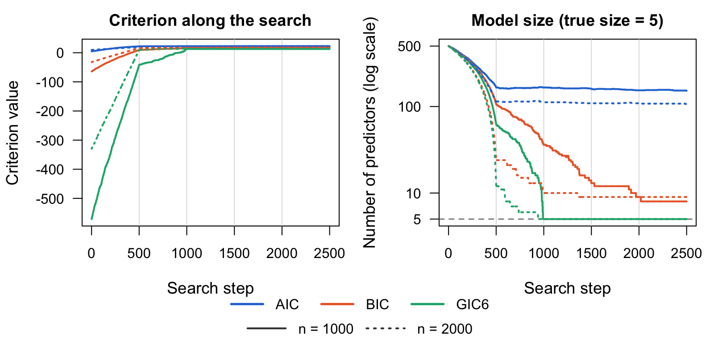
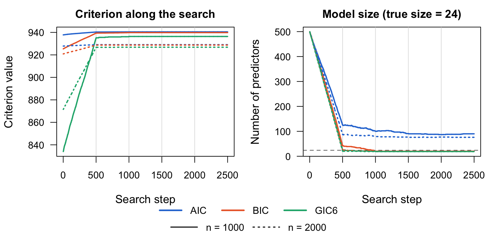
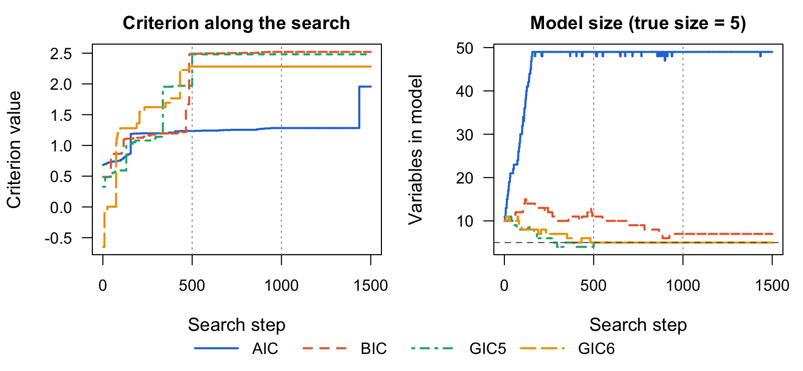
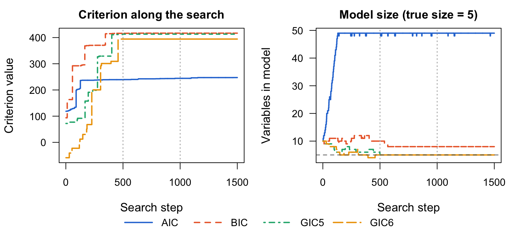
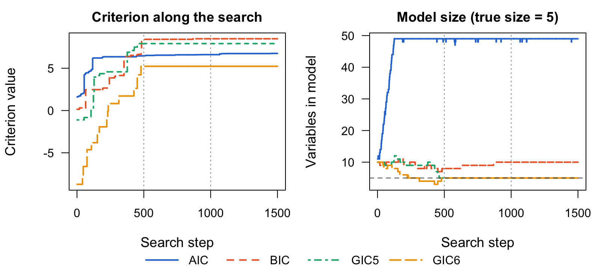

```{r, include = FALSE}
knitr::opts_chunk$set(
  collapse = TRUE,
  comment = "#>",
  eval = FALSE  # the code needs a local Julia installation
)
```

This article works through complete simulations: a high-dimensional linear
model, a multivariate normal model, and Poisson, binomial and multinomial
GLMs, all with $n = 1000$ observations and $p = 500$ candidate predictors. Each example compares four criteria. In increasing
order of penalty per variable, they are AIC ($c_n = 1$), BIC ($\log n$),
GIC5 ($\log\log n \, \log P$) and GIC6 ($\log n \, \log P$), where $n$ is
the sample size and $P$ the number of candidate predictors. See
`vignette("get-started")` for the setup steps and the other criteria. The
output shown was produced on an Apple M-series laptop with Julia 1.11.

```{r}
library(GICHighDimension)
setup_julia()
```

## Helpers

First define a few helpers. Data simulation and the search order use Julia's
random number generator, which `set.seed()` does not control, so
`set_seeds()` seeds both. Run the examples in the order shown to reproduce the
output.

```{r}
set_seeds <- function(seed) {
  set.seed(seed)
  JuliaCall::julia_command(sprintf("import Random; Random.seed!(%d);", seed))
}

criteria <- c(AIC = "Calculate_AIC", BIC = "Calculate_BIC",
              GIC5 = "Calculate_GIC5", GIC6 = "Calculate_GIC6")

# Run the search once per criterion
compare_criteria <- function(X, Y, init, k, Nsim) {
  lapply(criteria, function(crit)
    GICSelection(X, Y, init, crit, paste0(crit, "_short"), k = k, Nsim = Nsim))
}

last_model <- function(fit) sort(fit$selected_coeffs[[length(fit$selected_coeffs)]])

# Size, false positives and false negatives of each final model
selection_table <- function(fits, truth) {
  t(sapply(fits, function(fit) {
    s <- last_model(fit)
    c(size = length(s), false_pos = length(setdiff(s, truth)),
      false_neg = length(setdiff(truth, s)))
  }))
}
```

Each figure shows, for every criterion, its value and the number of selected
variables after each search step. Dotted lines mark a new pass over the
predictors, and the dashed line marks the true model size. Criteria with
larger penalties take lower values, so compare the shapes of the curves, not
their heights. The script
`data-raw/readme_figures.R` in the package source runs the code in this
section and redraws the figures.

## Linear model with 500 candidate predictors

Take $n = 1000$ and $p = 500$, with 5 true coefficients equal to 2 and the
noise set for a signal-to-noise ratio of $\beta^\top\Sigma\beta/\sigma^2 = 0.71$.
Start every search from the full model:

```{r}
set_seeds(1)
n <- 1000; p <- 500
X <- matrix(rnorm(n * p), n, p)
true_cols <- sort(sample(p, 5))
beta <- numeric(p); beta[true_cols] <- 2
Y <- LP_to_Y(X, beta, family = "Normal", std = sqrt(sum(beta^2) / 0.71))

fits <- compare_criteria(X, Y, 1:p, k = p, Nsim = 5)
selection_table(fits, true_cols)
#>      size false_pos false_neg
#> AIC   211       206         0
#> BIC     6         1         0
#> GIC5    5         0         0
#> GIC6    5         0         0
```



AIC keeps about 200 variables, because its penalty does not grow with $n$ or
$P$. BIC keeps all 5 true predictors and one noise variable. GIC5 and GIC6,
whose penalties grow with $\log P$, select exactly the true model, and GIC6,
the largest penalty, gets there fastest.

## Multivariate normal

Five responses, each with its own 5 predictors and coefficients from 10
down to 0.1. Pass the $n \times 5$ response matrix as `Y`:

```{r}
m <- 5
B <- matrix(0, p, m)
true_by_response <- vector("list", m)
for (i in 1:m) {
  cols <- sort(sample(p, 5))
  true_by_response[[i]] <- cols
  B[cols, i] <- seq(10, 0.1, length.out = 5)
}
Y_multi <- LP_to_Y(X, B, family = "MultivariateNormal", cov_matrix = diag(m))
true_union <- sort(unique(unlist(true_by_response)))

fits <- compare_criteria(X, Y_multi, 1:p, k = p, Nsim = 5)
selection_table(fits, true_union)
#>      size false_pos false_neg
#> AIC   276       251         0
#> BIC    20         0         5
#> GIC5   20         0         5
#> GIC6   20         0         5
```



BIC, GIC5 and GIC6 select the same 20 predictors with no false positives. The
5 they miss are the predictors with coefficient 0.1, one per response, which
are too small to detect with $n = 1000$. AIC finds those 5 too, but only
inside a model of 276 variables.

## Generalized linear models

For a non-Gaussian response, map it to the linear-predictor scale with
`Y_to_LP()`, select with `GICSelection()`, and then fit the selected model
with `Beta_estimate()`. The GLM examples reuse the design matrix `X` from
above ($n = 1000$, $p = 500$), with 5 true predictors, and start each search
from the first 10 columns.

```{r}
set_seeds(2)
true_cols <- c(3, 17, 42, 88, 150)
beta <- numeric(p); beta[true_cols] <- c(1, -1, 0.8, -0.8, 0.6)

compare_glm <- function(Y, ...) compare_criteria(X, Y_to_LP(Y, ...), 1:10, k = 50, Nsim = 3)
```

### Poisson regression

```{r}
y_pois <- LP_to_Y(X, beta, family = "Poisson")
fits <- compare_glm(y_pois, family = "Poisson")
selection_table(fits, true_cols)
#>      size false_pos false_neg
#> AIC    49        46         2
#> BIC     7         2         0
#> GIC5    5         0         0
#> GIC6    5         0         0

# Coefficients of the GIC6 model, intercept first
round(Beta_estimate(X[, last_model(fits$GIC6)], y_pois, family = "Poisson"), 2)
#> [1] -0.05  1.04 -1.02  0.80 -0.80  0.60
```



### Binomial counts (10 trials)

```{r}
y_binom <- LP_to_Y(X, beta, family = "Binomial", n_trials = 10)
fits <- compare_glm(y_binom, family = "Binomial", n_trials = 10)
selection_table(fits, true_cols)
#>      size false_pos false_neg
#> AIC    49        46         2
#> BIC     8         3         0
#> GIC5    5         0         0
#> GIC6    5         0         0
```



### Multinomial (three categories)

The coefficients form a $p \times 2$ matrix, and category 3 is the baseline:

```{r}
B_mn <- matrix(0, p, 2)
B_mn[true_cols, 1] <- 1.5
B_mn[true_cols, 2] <- c(-1.5, 1.5, -1.5, 1.5, -1.5)
y_mn <- LP_to_Y(X, B_mn, family = "Multinomial", n_categories = 3)
fits <- compare_glm(y_mn, family = "Multinomial", n_categories = 3)
selection_table(fits, true_cols)
#>      size false_pos false_neg
#> AIC    49        46         2
#> BIC    10         5         0
#> GIC5    5         0         0
#> GIC6    5         0         0
```



In all three GLMs, GIC5 and GIC6 select exactly the 5 true predictors. BIC
keeps the true predictors but adds 2 to 5 noise variables. AIC grows the
model until it hits the size cap (`k = 50`, so at most 49 variables) and
misses 2 true predictors.
